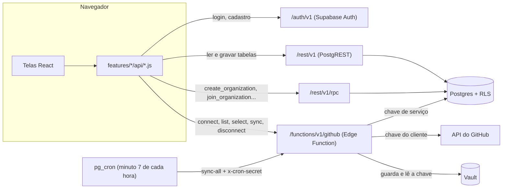

# API do GovTech MS

Como o front-end conversa com o back-end: quais endereços existem, quem pode chamar cada um, o que entra e o que sai. Estado de E5 (Índice de Governança).

> **Resumo:** não existe um servidor próprio. A API é o **Supabase**: o banco Postgres fica exposto como API REST, e as regras de acesso ficam **no banco** (RLS). Só o que não pode rodar no navegador (falar com o GitHub usando a chave do cliente) fica numa **Edge Function**.

---

## 1. Visão geral



São quatro portas de entrada, todas no mesmo projeto Supabase (`https://<projeto>.supabase.co`):

| Porta | Endereço | Para quê |
|---|---|---|
| Auth | `/auth/v1/...` | Cadastro, login, logout, sessão |
| REST | `/rest/v1/<tabela>` | Ler e gravar tabelas (projetos, membros, dados do GitHub) |
| RPC | `/rest/v1/rpc/<função>` | Ações que mexem em mais de uma tabela (criar organização, entrar por código) |
| Edge Function | `/functions/v1/github` | Tudo que usa a chave do GitHub |

O front **não monta essas URLs à mão**: usa o client `@supabase/supabase-js`, criado uma única vez em `frontend/src/shared/lib/supabase.js`. Pela regra do ESLint, só os arquivos `features/*/api/*.js` podem importar esse client; telas e hooks chamam as funções desses arquivos (§8).

---

## 2. Autenticação e chaves

| Chave | Onde fica | O que permite |
|---|---|---|
| **Publishable key** (`VITE_SUPABASE_PUBLISHABLE_KEY`) | No front (é pública por natureza) | Só identifica o projeto. Sozinha não lê nada: o papel `anon` não tem acesso a nenhuma tabela. |
| **Token de sessão (JWT)** | No navegador, chave `govtech-auth` do `localStorage` | Identifica o usuário logado. O banco lê o id dele com `auth.uid()`. |
| **Secret key / service role** | Só dentro da Edge Function (variável de ambiente do Supabase) | Ignora o RLS. Nunca vai para o front nem para o git. |
| **Chave do GitHub do cliente** | No **Vault** do Supabase (criptografada) | Ler os repositórios. O front só vê os 4 últimos caracteres. |
| **Senha do agendador** | No Vault (`github_cron_secret`) | Autoriza o `sync-all` (§6.3). |

Toda chamada do navegador leva dois cabeçalhos, que o client põe sozinho:

```http
apikey: <publishable key>
Authorization: Bearer <token de sessão do usuário>
```

---

## 3. Como as permissões funcionam

A regra de quem pode o quê **não está no front**. O front só pede; o banco decide. São três camadas:

1. **Privilégios de tabela e coluna (`grant`).** O papel `anon` (não logado) não acessa nenhuma tabela. O papel `authenticated` só pode escrever as colunas liberadas. Exemplo: em `projects`, ninguém grava `id`, `created_at`, `created_by` nem muda `organization_id` depois de criado.
2. **RLS (Row Level Security), ligada em todas as tabelas.** Cada policy filtra **quais linhas** o usuário enxerga ou altera. Todas usam duas funções auxiliares do schema `private`:
   - `private.is_org_member(org)`: o usuário é membro da organização?
   - `private.has_org_role(org, papéis)`: o usuário tem um desses papéis na organização?
3. **Triggers e funções com regra de negócio.** Exemplos: `keep_one_admin` impede a organização de ficar sem administrador; `delete_orphan_repository` apaga o repositório que não está em mais nenhum projeto.

**Consequência prática:** quando o usuário não tem permissão, o banco geralmente responde **"nenhuma linha"**, e não "proibido". Por isso o front trata "nenhuma linha voltou" como "não encontrado ou sem permissão" (§9).

### 3.1 Papéis

| Ação | admin | developer | stakeholder |
|---|:-:|:-:|:-:|
| Ver projetos, membros e dados do GitHub da organização | ✅ | ✅ | ✅ |
| Criar e editar projetos | ✅ | ✅ | — |
| Excluir projetos | ✅ | — | — |
| Mudar papel e remover membros; gerar novo código de convite | ✅ | — | — |
| Sair da organização (remover a si mesmo) | ✅ | ✅ | ✅ |
| Conectar, escolher repositórios e desconectar o GitHub | ✅ | — | — |
| Sincronizar o GitHub manualmente | ✅ | ✅ | — |

Quem cria a organização vira `admin`. Quem entra pelo código entra como `stakeholder`. O papel antigo `viewer` não existe mais: o banco recusa (constraint `organization_members_role_not_viewer`).

---

## 4. Tabelas (REST)

Endereço: `/rest/v1/<tabela>`. Todas pertencem a uma organização (`organization_id`) e só aparecem para os membros dela.

| Tabela | Ler | Inserir | Alterar | Excluir | Observações |
|---|---|---|---|---|---|
| `profiles` | o próprio e o dos colegas de organização | — (criado por trigger no cadastro) | o próprio, só `full_name` | — | `email` copiado do Auth por trigger |
| `organizations` | membros | — (só pela RPC `create_organization`) | admin, só `name` | — | `join_code` = código de convite |
| `organization_members` | membros | — (só pelas RPCs) | admin, só `role` | admin, ou o próprio membro (sair) | Trigger impede ficar sem admin |
| `projects` | membros | admin, developer | admin, developer | admin | A coluna `status` está sem uso (status é calculado, regra P3) |
| `github_credentials` | membros (sem `secret_id`) | — | — | — | Só a Edge Function escreve |
| `repositories` | membros | — | — | — | Um por empresa; cache do GitHub |
| `project_repositories` | membros | — | — | — | Liga projetos a repositórios (N:N) |
| `pull_requests` | membros | — | — | — | Os 100 mais recentes de cada repositório |
| `branches` | membros | — | — | — | Até 100 por repositório |
| `commits` | membros | — | — | — | Branch principal, últimos 90 dias |
| `governance_scores` | membros | — | — | — | Índice de Governança: uma linha por projeto e por dia (§6.6) |

As tabelas do GitHub são **somente leitura** para o usuário: não têm policy de escrita. Só a Edge Function grava nelas, com a chave de serviço, **depois** de conferir o papel de quem chamou.

### Exemplo: listar os projetos de uma organização

```js
// frontend/src/features/projects/api/projectsApi.js
supabase
  .from('projects')
  .select('id, name, description, deadline, owner, priority, progress')
  .eq('organization_id', organizationId)
  .order('created_at')
```

Equivale a:

```http
GET /rest/v1/projects?select=id,name,description,deadline,owner,priority,progress&organization_id=eq.<id>&order=created_at
```

O filtro `organization_id` **não é segurança** (o RLS já garante isso). Ele serve para quem participa de várias empresas ver só a empresa escolhida na tela.

---

## 5. Funções RPC

Endereço: `POST /rest/v1/rpc/<nome>`. A função pública é só uma "casca" que chama a versão em `private` (`security definer`, `search_path = ''`). Assim a lógica não fica exposta e roda com os privilégios necessários.

| Função | Quem chama | Parâmetros | Devolve | O que faz |
|---|---|---|---|---|
| `create_organization` | qualquer logado | `org_name` | `uuid` | Cria a organização e põe quem chamou como admin |
| `join_organization` | qualquer logado | `code` | `uuid` | Entra como stakeholder. Código inválido → erro `P0002` (não revela se a organização existe) |
| `regenerate_join_code` | admin | `org` | `text` | Gera um novo código de convite; o antigo para de funcionar |
| `github_save_token` | só a Edge Function | projeto, chave, login, usuário | — | Guarda a chave no Vault e registra a conexão |
| `github_read_token` | só a Edge Function | `p_project_id` | `text` | Lê a chave do Vault |
| `github_disconnect` | só a Edge Function | `p_project_id` | — | Apaga as ligações e a conexão; o trigger apaga a chave do Vault |
| `github_cron_secret` | só a Edge Function | — | `text` | Lê a senha do agendador |

As quatro últimas só podem ser executadas pelo papel `service_role`. Um usuário logado que tente chamá-las recebe erro de permissão.

---

## 6. Edge Function `github`

Endereço: `POST /functions/v1/github`. Código em `backend/supabase/functions/github/` (`index.js` = rotas e permissões; `github.js` = chamadas ao GitHub e conversão dos dados, com testes).

### 6.1 Formato do pedido

Sempre `POST` com JSON. O campo `action` escolhe o que fazer:

```json
{ "action": "sync", "projectId": "<uuid do projeto>" }
```

Para cada pedido, a função:
1. confere o login (`auth.getUser` com o token do cabeçalho), senão responde **401**;
2. lê o projeto **com o login do usuário**, para o RLS decidir se ele enxerga o projeto (senão **404**);
3. confere o papel dele na organização (senão **403**);
4. só então usa a chave de serviço para ler o Vault e gravar os dados.

> `verify_jwt` está desligado na configuração da função porque o agendador chama sem login. A conferência do login é feita no código (passo 1) em todas as ações, exceto `sync-all`, que usa a senha do agendador.

### 6.2 Ações

| `action` | Quem | Campos extras | Resposta de sucesso |
|---|---|---|---|
| `connect` | admin | `token` (chave do GitHub) | `{ login, repositoryCount }` |
| `list` | admin | — | `{ repositories: [{ githubId, fullName, description, private, selected }] }` |
| `select` | admin | `githubIds: number[]` | o mesmo resumo de `sync` (escolhe e já sincroniza) |
| `sync` | admin, developer | — | `{ repositoryCount, unavailableCount, pullRequestCount, branchCount, commitCount, syncedAt }` |
| `disconnect` | admin | — | `{ disconnected: true }` |
| `sync-all` | agendador | cabeçalho `x-cron-secret` | **202** `{ started: true }` |

Detalhes:
- **`connect`** testa a chave no GitHub antes de guardar. Chave sem nenhum repositório liberado é recusada.
- **`select`** só aceita repositórios que a chave enxerga. Os desmarcados saem do projeto; se nenhum outro projeto da empresa usa o repositório, ele e seus dados são apagados (regra G5).
- **`sync`** busca os dados atuais, grava os novos e **apaga o que não veio mais** do GitHub (PR, branch ou commit que sumiu, ou commit com mais de 90 dias). Ao terminar, grava `last_synced_at` e limpa `last_sync_error`.
- **`unavailableCount`**: repositórios escolhidos que a chave deixou de enxergar (ex.: permissão retirada no GitHub).
- Depois de `sync` e `select`, a função também apura o **Índice de Governança** do projeto (§6.6).

### 6.3 Sincronização automática (`sync-all`)

- O `pg_cron` do Supabase roda o job `github-sync-hourly` no **minuto 7 de cada hora**. Ele faz um `POST` para a função com `{"action": "sync-all"}` e o cabeçalho `x-cron-secret`.
- A função compara a senha com a do Vault (comparação em tempo constante), responde **202** na hora e continua o trabalho em segundo plano (`EdgeRuntime.waitUntil`).
- Sincroniza um projeto por vez. Se um falhar (ex.: chave expirada), a mensagem vai para `github_credentials.last_sync_error`, a tela mostra o aviso e os outros projetos continuam.

### 6.4 O que é buscado no GitHub

Por repositório escolhido, em paralelo:

| Dado | Chamada | Limite |
|---|---|---|
| Repositórios visíveis | `GET /user/repos?per_page=100&sort=pushed` | 100 |
| Pull requests (com nº de aprovações) | GraphQL `repository.pullRequests` | 100 mais recentes |
| Branches (com proteção) | `GET /repos/{dono}/{repo}/branches?per_page=100` | 100 |
| Commits da branch principal | `GET /repos/{dono}/{repo}/commits?since=<90 dias>` | 3 páginas (300) |

Repositório vazio (GitHub responde 409) conta como "sem commits", não como erro.

### 6.6 Índice de Governança

- Calculado em `functions/github/score.js` (regras I1–I6 de `REGRAS_DE_NEGOCIO.md` §5.1) e gravado em `governance_scores`: uma linha por projeto e por dia, no fuso de MS, com a nota (`score`, 0–100 ou null) e a nota de cada critério (`components`).
- Apurado depois de cada `sync`/`select` (só o projeto da ação) e no fim de cada `sync-all` (todos os projetos, inclusive os sem GitHub, por causa do prazo). Vale a última apuração do dia.
- Na primeira apuração de um projeto, os dias anteriores (até 30) são recalculados pelas datas dos PRs, a partir do primeiro PR, e marcados `reconstructed`.
- Uma falha no índice não derruba a sincronização: vai só para o log da função.
- O front lê com `loadGovernanceData` (últimos 31 dias) e só organiza para a tela (`shared/lib/governanceScore.js`).

### 6.5 Erros

A resposta de erro é sempre `{ "error": "<mensagem em pt-BR, pronta para a tela>" }`:

| Status | Quando |
|---|---|
| 400 | Pedido inválido, chave curta, nenhum repositório escolhido, ou **problema com a chave do GitHub** (inválida, sem permissão, limite de chamadas) |
| 401 | Sem login, ou senha do agendador errada |
| 403 | O papel não permite a ação |
| 404 | Projeto não existe ou o usuário não o enxerga |
| 405 | Método diferente de `POST` |
| 500 | Falha ao gravar no banco ou erro inesperado (detalhe só no log da função) |
| 502 | O GitHub está fora do ar ou respondeu com erro 5xx |

Problema com a chave do GitHub volta como **400**, e não 401, de propósito: o client do Supabase trataria um 401 como sessão expirada do usuário.

---

## 7. Fluxos completos

**Cadastro e primeira empresa**
1. `signUp` → Auth cria o usuário; o trigger `on_auth_user_created` cria o `profile`.
2. `create_organization('Prefeitura X')` → organização + usuário como admin.
3. Colegas usam `join_organization(código)` e entram como stakeholder; o admin promove quem precisar.

**Ligar um projeto ao GitHub**
1. Admin cola a chave → `connect` (chave vai para o Vault).
2. Tela lista os repositórios → `list`.
3. Admin marca os repositórios → `select` (liga e sincroniza).
4. Depois disso: `sync` manual (admin ou developer) ou automático a cada hora.

**Visão geral**
1. `loadGovernanceData(organizationId)` lê `repositories`, `pull_requests`, `branches` e `commits` (últimos 90 dias) da empresa.
2. As métricas, os alertas e o status de cada projeto são calculados **no navegador**, em `shared/lib/governance.js` (regras em `REGRAS_DE_NEGOCIO.md` §5 e §6). Não há endpoint de métricas.

---

## 8. Camada de API no front

Cada feature tem sua pasta `api/`. Os hooks (TanStack Query) chamam essas funções; as telas usam os hooks.

| Arquivo | Funções | Usa |
|---|---|---|
| `features/auth/api/authApi.js` | `signIn`, `signUp`, `signOut`, `onSessionChange`, `listMyOrganizations`, `createOrganization`, `joinOrganization` | Auth, `organization_members`, RPCs |
| `features/projects/api/projectsApi.js` | `listProjects`, `createProject`, `updateProject`, `deleteProject` | `projects` |
| `features/projects/api/githubApi.js` | `connectGitHub`, `listAvailableRepositories`, `selectRepositories`, `syncGitHub`, `disconnectGitHub`, `getGitHubConnection` | Edge Function, `github_credentials`, `project_repositories` |
| `features/rbac/api/membersApi.js` | `listMembers`, `updateMemberRole`, `removeMember`, `regenerateJoinCode` | `organization_members`, `profiles`, RPC |
| `features/repositories/api/repositoriesApi.js` | `listRepositoryData` | `repositories`, `pull_requests`, `branches` |
| `features/dashboard/api/governanceApi.js` | `loadGovernanceData` | `repositories`, `pull_requests`, `branches`, `commits`, `governance_scores` |

Chaves de cache do TanStack Query: `['projects', orgId]`, `['members', orgId]`, `['repository-data', orgId, projectId | 'all']`, `['governance', orgId]`. Todas incluem a empresa, para os dados de duas empresas nunca se misturarem.

---

## 9. Tradução de erros do banco

As funções de `api/` transformam o erro técnico numa mensagem em pt-BR antes de chegar à tela:

| Código | Origem | Mensagem na tela |
|---|---|---|
| `PGRST116` | Nenhuma linha voltou (não existe **ou** RLS barrou) | "Projeto não encontrado ou sem permissão para alterá-lo." |
| `42501` | Privilégio insuficiente | "Você não tem permissão para esta ação." |
| `P0001` | Regra do banco com mensagem própria (ex.: último admin) | A própria mensagem do banco |
| `P0002` | Código de convite inválido | "Código de organização inválido." |
| `invalid_credentials`, `email_not_confirmed`, ... | Supabase Auth | Mensagens em `authApi.js` |
| outros | — | "Não foi possível falar com o servidor. Tente de novo." |

---

## 10. Como a API é testada

| O quê | Onde | Ferramenta |
|---|---|---|
| Policies de RLS (positivo e negativo para cada papel), RPCs, triggers | `backend/supabase/tests/*.test.sql` | pgTAP (`npx supabase test db`) |
| Conversão dos dados do GitHub, mensagens de erro e cálculo do índice | `backend/supabase/functions/github/*.test.js` | `node --test` (roda no CI) |
| Camada `api/` do front e telas | `frontend/src/**/__tests__` | Vitest + MSW, que simula o Supabase e a Edge Function (`src/test/msw`) |

---

## 11. Limites conhecidos

- **Repositórios visíveis:** a lista de escolha mostra só os 100 com push mais recente.
- **Histórico:** são guardados os 100 PRs mais recentes, até 100 branches e até 300 commits (90 dias) por repositório. Para métricas de um período maior, seria preciso paginar.
- **Uma chave por projeto:** um repositório usado por dois projetos é sincronizado pela chave de qualquer um deles.
- **Sem limite de taxa próprio:** a Edge Function depende do limite do GitHub (5.000 chamadas por hora por chave) e do Supabase.
- **Auditoria:** a tabela `audit_events` prevista no plano ainda não existe; as alterações não ficam registradas.
