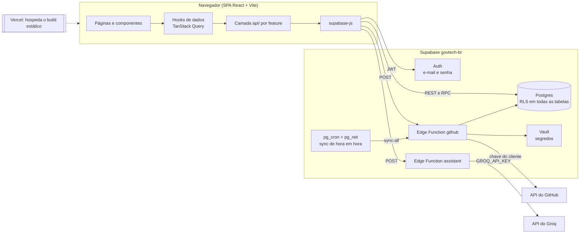
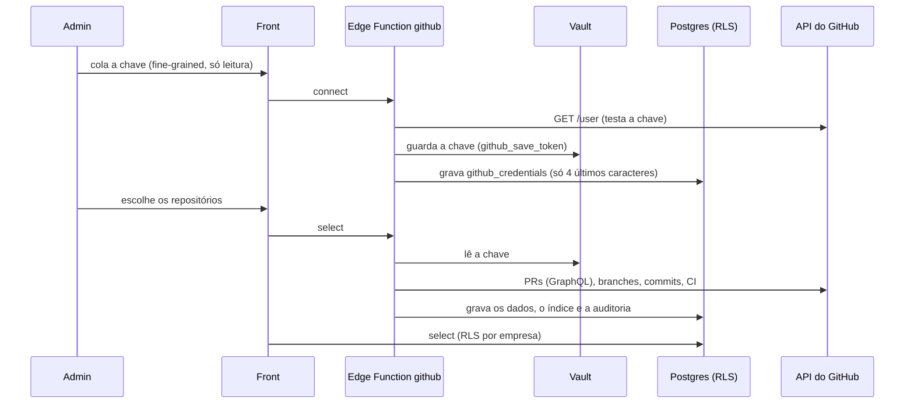

# GovTech — Plano Técnico

Arquitetura, decisões e histórico de execução do GovTech. Este documento foi **reescrito para o estado atual** (depois do PR #52, entregas E1 a E11): o que era proposta virou "como ficou", e o que não foi feito está em [§13](#13-pendências-e-trabalhos-futuros).

- **Regras do produto:** [`REGRAS_DE_NEGOCIO.md`](./REGRAS_DE_NEGOCIO.md) (fonte única).
- **API** (tabelas, RPCs, Edge Functions, erros): [`API.md`](./API.md).
- **Mapa de testes:** [`TESTES.mmd`](./TESTES.mmd). **Funcionamento do sistema:** [`../DOCUMENTACAO.md`](../DOCUMENTACAO.md). **Relatório do TCC:** [`RELATORIO_TCC.md`](./RELATORIO_TCC.md).
- **Banco e Edge Functions** (como publicar, como testar): [`../backend/README.md`](../backend/README.md).

## Índice

1. [Estado do projeto](#1-estado-do-projeto)
2. [Decisões do time](#2-decisões-do-time)
3. [Arquitetura](#3-arquitetura)
4. [Back-end (Supabase)](#4-back-end-supabase)
5. [Front-end](#5-front-end)
6. [Estratégia de testes](#6-estratégia-de-testes)
7. [Qualidade e fluxo de trabalho](#7-qualidade-e-fluxo-de-trabalho)
8. [Responsividade e acessibilidade](#8-responsividade-e-acessibilidade)
9. [Roadmap e entregas](#9-roadmap-e-entregas)
10. [Registro de decisões de execução](#10-registro-de-decisões-de-execução)
11. [Riscos e segurança](#11-riscos-e-segurança)
12. [Ferramentas de IA e consumo de tokens](#12-ferramentas-de-ia-e-consumo-de-tokens)
13. [Pendências e trabalhos futuros](#13-pendências-e-trabalhos-futuros)
14. [Referências](#14-referências)

---

## 1. Estado do projeto

Prazo do TCC: **18/11/2026**. Equipe de 2 pessoas, com branch por tarefa e PR revisado pelo colega.

| Fase | Situação |
|---|---|
| Limpeza, qualidade (ESLint, Prettier, Husky) e testes P0 | ✅ |
| Nova estrutura (`frontend/` + `backend/`, features, CSS Modules, rotas aninhadas) | ✅ |
| Supabase: schema, RLS, Auth, membros, GitHub, índice, IA, auditoria, CI, estratégia | ✅ (12 migrations) |
| E1 a E11 (ver §9) | ✅ todas no ar |
| Folga: testes, documentação do TCC e ensaio | em andamento |

**Números atuais:** 27 arquivos e 222 testes no front (Vitest), 11 arquivos de teste pgTAP, testes `node --test` das duas Edge Functions, CI verde em lint, testes e build.

**O que ainda não funciona (de propósito):** as abas Notificações e Segurança de Configurações e o sino do topo estão marcados como "em desenvolvimento".

---

## 2. Decisões do time

Respondidas em 31/10/2026, com as consequências já aplicadas.

| # | Pergunta | Decisão | Como ficou |
|---|---|---|---|
| Q1 | Data de entrega | **18/11/2026** | Escopo recortado; webhook, GitHub App e e2e completo ficaram fora (§13) |
| Q2 | Multi-organização? | **Sim**. Projeto Supabase **`govtech-br`**, região `sa-east-1` (São Paulo), por LGPD e latência | Troca de empresa na barra lateral (E2) |
| Q3 | Cadastro | **Aberto**: a pessoa cria uma empresa (vira admin) ou entra com o código | Quem entra pelo código vira **stakeholder** (o papel `viewer` foi removido em 03/11/2026) |
| Q4 | Autenticação e rotas | Entra com o Supabase | ✅ Supabase Auth + `ProtectedRoute` + RLS |
| Q5 | TypeScript? | **Não** | JavaScript; zod valida as bordas |
| Q6 | Status do projeto | Era **manual** | **Mudou em 02/11/2026 (P3):** o status é **calculado pelos alertas**; o campo manual saiu |
| Q7 | Auditoria | Só para revisão | Triggers e `audit_record`, sem cadeia de hash, imutável (E7) |
| Q8 | Dados pessoais | Nome, e-mail e chave do GitHub | Chave no Vault; de pessoas do GitHub, só login e avatar público |
| Q9 | Chatbot com IA | **Sim**, Groq (plano gratuito) | ✅ E6 |
| Q10 | Landing page | Fica, em pasta separada | `frontend/src/landing/`, carregada sob demanda |
| Q11 | Pausa do Supabase Free | Ok | Reativar na véspera da defesa |
| Q12 | Pessoas no projeto | 2 | Branch por tarefa e PR revisado |
| Q13 | Fórmulas dos KPIs | "Pode deixar" | **Superado:** todas as métricas são calculadas (regra "não inventar métricas") |
| — | Separar back e front | Sim | `frontend/` e `backend/` na raiz |
| — | Repositório | GitHub `oguilhermekenzo/govtech`, depois organização `govtechbr` | PRs para a `main` |
| — | Chave do GitHub | **Uma por projeto**, cadastrada pelo admin | ✅ |

---

## 3. Arquitetura



**Princípios**
1. **O banco é a fronteira de segurança.** O front esconde botões por conveniência; quem impede é a RLS.
2. **Nenhum segredo no front.** O navegador só conhece a *publishable key*. A *secret key*, a chave do GitHub e a do Groq ficam no servidor.
3. **Schema como código.** Toda mudança de banco é uma migration versionada; nunca um clique no painel de produção.
4. **Front desacoplado do provedor.** Componentes não importam `supabase`; só `features/*/api/` (regra do ESLint).
5. **Cálculo onde faz sentido.** Métricas, alertas e status são calculados no navegador (`shared/lib/governance.js`) para bater com a tela. O **Índice de Governança** é calculado e gravado no servidor (`score.js`), para ter uma fonte de verdade e histórico diário sem depender de alguém abrir o app.

---

## 4. Back-end (Supabase)

### 4.1 Serviços usados
Postgres, Auth (e-mail e senha), RLS, **Vault** (segredos), **pg_cron** + **pg_net** (agendador), **Edge Functions** (Deno, JavaScript). Não usamos Realtime, Storage nem GitHub OAuth.

### 4.2 Modelo de dados (atual)
15 tabelas em `public`, todas com RLS e policies por operação. Detalhes de colunas e permissões em [`API.md`](./API.md) §4.

| Grupo | Tabelas |
|---|---|
| Acesso | `profiles`, `organizations` (com `mission` e `vision`), `organization_members` |
| Projetos e estratégia | `projects` (com `objective_id`), `strategic_objectives` |
| GitHub (só leitura para o usuário) | `github_credentials`, `repositories`, `project_repositories` (N:N), `pull_requests`, `branches`, `commits`, `ci_runs` |
| Governança | `governance_scores`, `audit_events` (imutável), `assistant_usage` (sem acesso pelo front) |

As colunas `projects.status` e `projects.progress` continuam no banco, **sem uso**, para não fazer migration destrutiva antes da banca; apagá-las é uma sugestão para depois.

### 4.3 Migrations (12)

| Migration | O que faz |
|---|---|
| `core_schema` | Perfis, empresas, membros, projetos; RLS; RPCs `create_organization`, `join_organization`, `regenerate_join_code`; trigger do último admin |
| `members` | Tela de RBAC real |
| `github` | Chave no Vault, repositórios, PRs e branches |
| `drop_project_repositories` | Remove a coluna antiga (separada para não quebrar a produção entre a migration e o merge) |
| `repository_selection` | Viewer vira stakeholder; repositório único por empresa; `project_repositories` N:N |
| `github_sync_hourly` | Aprovações, commits, `last_sync_error`, senha do agendador no Vault e job `github-sync-hourly` |
| `governance_scores` | Índice de Governança por projeto e dia |
| `assistant_usage` | Contagem diária de perguntas à IA |
| `audit_events` | Trilha imutável, triggers e `audit_record` |
| `ci_status` | `ci_state` em PRs e repositórios |
| `ci_runs` | Execuções do GitHub Actions |
| `strategic_objectives` | Missão, visão, objetivos e vínculo do projeto |

**Regras do banco:** policies usam `(select auth.uid())`; colunas usadas em policy têm índice; funções `security definer` ficam no schema `private` com `set search_path = ''` e o front chama só as "cascas" em `public`; `audit_events` só é escrita pelo banco; toda policy nova tem teste pgTAP positivo e negativo.

### 4.4 Como as mudanças chegam ao banco (sem Docker)
1. A mudança é uma **nova migration** revisada no PR.
2. Com **aprovação explícita**, é aplicada no `govtech-br` pelo MCP do Supabase (`apply_migration`), nunca pelo painel. Se o MCP recusar (SQL com `delete`/`update`), o dono cola o **arquivo versionado** no SQL Editor e a versão é registrada pelo MCP.
3. Depois: **Security Advisor** e **testes pgTAP**.
4. **Ordem de publicação:** migration antes da Edge Function que grava a coluna nova.
5. Migration aplicada não é editada; correção é migration nova.

Ainda não usamos `supabase start`, `db reset` nem `db push` (planejados, não adotados). Detalhes em [`../backend/README.md`](../backend/README.md).

### 4.5 Integração com o GitHub
Sem webhook nem GitHub App (não cabiam no prazo): sincronização **de hora em hora** e pelo botão.



- **Chave:** *fine-grained personal access token*, só leitura (Metadata, Contents, Pull requests, Commit statuses e Actions). Uma por projeto. Fica no Vault; `github_credentials` guarda só a referência (`secret_id`) e os metadados.
- **Sem duplicidade:** cada repositório existe uma vez por empresa e é ligado aos projetos por `project_repositories`.
- **Agendador:** job `github-sync-hourly` (`7 * * * *`), com `x-cron-secret` (senha gerada no Vault, comparada em tempo constante). Responde 202 e continua em segundo plano; a falha de um projeto não para os outros.
- **LGPD:** de pessoas de fora, só login e avatar público; commits sem nome, e-mail nem mensagem; execuções do CI sem quem disparou.
- **Paginação (G9):** tetos em `functions/github/github.js`; passou do teto, a sincronização marca "dados parciais".

### 4.6 Índice de Governança
Calculado em `functions/github/score.js` (puro, testado) e gravado em `governance_scores` depois de cada sincronização: uma linha por projeto e por dia (fuso de MS). Pesos: revisão de código 30, fluxo de PRs 20, prazo 20, proteção da branch 15, lead time 15; critério sem dado sai da conta. Faixas: Bom ≥ 80, Regular 60–79, Crítico < 60. Na primeira apuração, os 30 dias anteriores são reconstruídos a partir do primeiro PR e marcados como recalculados. O CI **não** entra no índice, para não quebrar a série histórica.

### 4.7 Assistente de Governança com IA
Edge Function `assistant`: o navegador monta os dados da empresa com os mesmos cálculos dos painéis; a função valida, confere a empresa, conta o limite (`assistant_consume`: 20 por pessoa e 200 no total por dia) e chama o **Groq** (`openai/gpt-oss-120b`, plano gratuito). Nada de login, avatar, e-mail ou chave vai para a IA; a conversa não é guardada. Os dados vão numa mensagem marcada como "dados, não instruções" (defesa contra *prompt injection*). O Groq foi escolhido porque, pelos termos lidos em 02/11/2026, não treina com os dados e não guarda os pedidos por padrão; o Gemini gratuito foi descartado por usar os dados para treino.

### 4.8 Auditoria
Triggers em `projects`, `organization_members`, `organizations` e `strategic_objectives`, mais `audit_record` (só `service_role`) para as ações da Edge Function. O evento guarda a ação, quem agiu (id, nome e papel), o alvo e o diff só dos campos que mudaram. **Imutável** até para a chave de serviço (exceto as cascatas do próprio banco). Visível para admin e stakeholder. Lista de ações em [`API.md`](./API.md) §6.8.

### 4.9 Estratégia e Processos (E10 e E11)
- **Estratégia:** missão, visão e objetivos da empresa (só o admin edita); um projeto se liga a no máximo um objetivo; o status do objetivo é o pior entre os projetos ligados. O objetivo em Risco ou Atenção mostra os alertas dos projetos (relaciona a falha técnica à meta de negócio, sem estimar custo nem prazo).
- **Processos:** mapa fixo de 4 áreas do CMMI-DEV 1.3 (VER, CM, PMC, MA) para os critérios do índice. É **evidência de apoio**, não avaliação de maturidade. Não há tabela nova: usa as notas de `governance_scores`.

---

## 5. Front-end

### 5.1 Estrutura
```
frontend/src/
├── app/        providers, rotas e adaptadores (routes.jsx)
├── landing/    página institucional
├── features/   auth, dashboard, projects, repositories, strategy, processes, audit, rbac, assistant, settings
│               (cada uma: api/, hooks/, components/, utils/, __tests__/)
├── shared/     layout, ui, hooks, lib, constants
├── mocks/      dados de exemplo (só os testes usam)
├── styles/     tokens.css, index.css, app.css
└── test/       setup, renderWithRouter e o Supabase simulado (msw/)
```
Regras do ESLint: imports pelo alias `@/`, sem `../`; **uma feature não importa outra** (o que atravessa features chega por prop nos adaptadores de `app/routes.jsx`); só `features/*/api/` importa o client do Supabase.

### 5.2 Decisões técnicas

| Tema | Decisão | Alternativa descartada | Por quê |
|---|---|---|---|
| Estilo | **CSS Modules** + tokens | Tailwind | Zero dependência nova, escopo por componente, media query |
| Rotas | Rotas aninhadas com `<Outlet>` + `lazy()` na landing | `switch` por estado | Removeu a navegação duplicada; code-splitting da landing |
| Estado de servidor | **TanStack Query v5** | `useEffect` manual | Cache, invalidação, loading e erro prontos |
| Formulários | **react-hook-form + zod** | estado manual | Validação declarativa |
| Campos | `Select` e `DatePicker` próprios | `<select>` e `<input type="date">` nativos | Visual e acessibilidade iguais em todo navegador |
| Toast | `ToastProvider` + `useToast()` | prop em cascata | Sem *prop drilling* |
| Ícones | Importar o componente do Lucide | mapa de strings | Erro vira erro de build |
| Linguagem | **JavaScript** | TypeScript | Decisão Q5 |

### 5.3 Componentes compartilhados (`shared/ui`)
`Modal` (foco preso, `Esc`, folha no celular), `Select`, `DatePicker`, `Tooltip`, `StatCard`, `StatusBadge`, `ScoreBreakdown`, `Toast`/`ToastProvider`, `Brand`, `Icon`. Os itens do plano original que **não** foram criados (`Button`, `Card`, `Tabs`, `DataTable`, `EmptyState`, `Skeleton`, `ProgressBar`, `Switch`) continuam como classes CSS globais (`.primary-button`, `.panel`…); extrair é melhoria futura.

---

## 6. Estratégia de testes

Modelo *Testing Trophy*: mais testes de integração de componente, apoiados por análise estática e unitários das regras puras.

| Camada | Ferramenta | Situação |
|---|---|---|
| Estática | ESLint (react, hooks, jsx-a11y), Prettier | ✅ no pre-commit e no CI; falha com qualquer warning |
| Unitário e componente | **Vitest** + Testing Library + user-event + jest-dom | ✅ 27 arquivos, 222 testes |
| Mock de rede | **MSW**, `onUnhandledRequest: 'error'` | ✅ simula o Supabase e as Edge Functions |
| Edge Functions | `node --test` | ✅ no CI (job `edge-functions`) |
| Banco e RLS | **pgTAP**, positivo e negativo por papel | ✅ 11 arquivos, rodados no SQL Editor com `to_sql_editor.py` |
| E2E | Playwright | ⏳ não implementado |
| Acessibilidade automática | axe | ⏳ não implementado (há asserções por `getByRole` e ARIA nos componentes) |

**Convenções:** testar comportamento (`getByRole`/`getByLabelText`, nunca classe CSS); datas com `vi.setSystemTime`; arquivo de teste em `__tests__/` ao lado do código; bugfix começa por um teste que falha. Um bug de contagem de dias do prazo (horário de verão) foi encontrado pelos primeiros testes e corrigido em 01/11/2026.

**CI** (`.github/workflows/ci.yml`, em todo PR e no push da `main`): `npm ci`, `lint`, `test:run`, `build` no front; `node --test` nas Edge Functions. Os pgTAP rodam à mão no banco remoto, e depois o banco é conferido (nenhum usuário `@test.local` nem `pgtap` ficam para trás).

---

## 7. Qualidade e fluxo de trabalho

- **ESLint 9** (flat config) com `react`, `react-hooks`, `jsx-a11y` e as regras de fronteira entre pastas; `--max-warnings 0`. **Prettier** e **Husky + lint-staged** no pre-commit; fim de linha LF.
- **Git:** nunca commitar na `main`; branches `feat/`, `fix/`, `refactor/`, `test/`, `docs/`; Conventional Commits em inglês; não misturar mover arquivo com mudar lógica; PR só com `lint`, `test:run` e `build` verdes.
- **Aprovação:** planejar, pedir aprovação e só então implementar (arquitetura, schema, dependências, exclusões). Regra nova passa por `REGRAS_DE_NEGOCIO.md` antes do código.
- **Deploy:** Vercel, Root Directory `frontend`, `vercel.json` com rewrite da SPA. Variáveis: `VITE_SUPABASE_URL` e `VITE_SUPABASE_PUBLISHABLE_KEY`.
- **Definição de pronto:** critério de aceite demonstrado, lint/testes/build verdes, funciona em 390 px e 1440 px quando há UI, docs atualizadas.

---

## 8. Responsividade e acessibilidade

- **Mobile-first**, com um conjunto único de breakpoints: **640, 768, 1024 e 1280 px** (antes eram 10 valores diferentes). Variáveis CSS não funcionam em `@media`, então os valores são usados literalmente e documentados em `tokens.css`.
- A barra lateral vira *drawer* em telas menores; o `Modal` vira folha embaixo abaixo de 640 px.
- Telas novas usam CSS Modules e tokens; ainda restam **estilos inline** em telas antigas (ex.: Configurações) e em `app.css`.
- Acessibilidade: foco preso e `Esc` nos diálogos, `aria-describedby` nos erros de formulário, tooltips acessíveis por teclado e toque, gráficos com tabela para leitor de tela, `role="status"` nos avisos.
- **Não feito:** auditoria sistemática em 360/390/768/1024/1440 px com screenshots, Lighthouse mobile e Playwright em 3 viewports (§13).

---

## 9. Roadmap e entregas

| Fase | Resultado |
|---|---|
| ✅ Limpeza (31/10) | Navegação única, chaves de storage, código morto e `console.log` removidos |
| ✅ Qualidade (31/10) | ESLint 9, Prettier, Husky, LF |
| ✅ Testes (01/11) | Vitest, Testing Library, MSW, CI |
| ✅ Nova estrutura (01/11) | `frontend/` + `backend/`, features, `shared/`, CSS Modules, rotas aninhadas, camada `api/` |
| ✅ Supabase (02–10/11) | Entregas abaixo |
| Folga (13–18/11) | Testes, documentação do TCC, ensaio |
| 🎓 Defesa | 18/11 |

| # | Entrega | Regras |
|---|---|---|
| — | Base: Auth, empresas, membros, projetos com RLS | A1–A4, P1–P5 |
| — | Tela de membros (RBAC real) | A3, A4, §2 |
| — | Integração com o GitHub (chave no Vault, Edge Function `github`) | G1 |
| E1 | Seleção de repositórios (N:N) e fim do viewer | A2, G2–G5 |
| E2 | Troca de empresa | A5, A6 |
| E3 | Mais dados do GitHub e sincronização a cada hora | G6–G8 |
| E4 | Visão geral com métricas reais, alertas e status automático | P3, P4, §5, §6 |
| E5 | Índice de Governança (0–100) com histórico | I1–I6 |
| E6 | Assistente de Governança com IA | IA1–IA6 |
| E7 | Auditoria real e paginação do GitHub | AU1–AU7, G9 |
| E8 | Status do CI | G10 |
| E9 | Histórico de execuções do CI | G11 |
| E10 | Direcionadores estratégicos | S1–S7 |
| E11 | Processos: evidências por área do CMMI | C1–C6 |
| — | Busca global com dados reais; sino e abas Notificações/Segurança em desenvolvimento; correção do alerta de CI já corrigido (#52) | — |

---

## 10. Registro de decisões de execução

Decisões tomadas durante a implementação que não aparecem nas regras.

**Base e GitHub**
- **Ordem do deploy:** a remoção da coluna `projects.repositories` virou migration à parte, para não quebrar o site entre a migration e o merge.
- **Casamento repositório ↔ id:** o upsert não garante a ordem; a sincronização casa pelo `github_id`.
- **Erro de chave do GitHub = HTTP 400**, não 401: o client do Supabase trataria um 401 como sessão expirada.
- **Sem `@supabase/server`:** a Edge Function usa o mesmo `supabase-js` do front, sem dependência nova.
- **Erro de desenho (G1):** a chave *fine-grained* lê **todos os repositórios públicos**, não só os escolhidos ao criá-la; o primeiro teste real trouxe 18 repositórios em vez de 1. Corrigido na E1 com a escolha explícita dos repositórios.
- **Chave sem *Checks*:** chave fine-grained não tem a permissão "Checks"; o CI usa *Commit statuses* e *Actions*.
- **`verify_jwt` desligado** na `github` (o agendador chama sem login); o login é conferido no código em todas as ações, menos `sync-all`.

**E2 (troca de empresa)**
- Bug encontrado e corrigido: quem estava em duas empresas via os dados misturados (o RLS libera todas as empresas do usuário e a tela não filtrava). Agora tudo filtra por `organization_id` e a empresa entra na chave do TanStack Query.
- A última empresa usada fica no `localStorage` (`govtech:last-organization`); trocar de empresa remonta as telas.

**E3 e E4**
- Achado: no repositório de demonstração nenhum PR tinha aprovação, então todo PR mergeado gera o alerta de "sem aprovação". É o comportamento certo; vale combinar a demonstração.
- O alerta "mergeado sem aprovação" olha 30 dias fixos, para o status não mudar quando se troca o período da tela. Projeto sem prazo não gera alerta de prazo.
- O cálculo de métricas ficou no navegador para bater com a tela; o status chega a Projetos e Estratégia pelos adaptadores de `app/routes.jsx`.

**E5 (índice)**
- A primeira versão da reconstrução começava 30 dias antes mesmo sem atividade e mostrava nota estável em dias sem PR; corrigido para começar no primeiro PR (com teste).
- Efeito aceito: mudar o prazo só reflete no índice na apuração seguinte (a tela mostra "apurado às HH:MM").

**E6 (IA)**
- O `ChatbotModal` antigo (FAQ fixa) foi apagado. Um contexto forjado só engana quem o forjou: a função não lê dados de outras empresas.

**E7 (auditoria)**
- O `AGENTS.md` foi ajustado: `audit_events` é "escrita só pelo banco (trigger ou função `security definer`)", porque nas ações da Edge Function `auth.uid()` é nulo.
- Imutabilidade com exceção para cascatas do próprio banco (`pg_trigger_depth() > 1`): excluir a empresa e limpar o `actor_id` de conta excluída.

**Revisão do dono (02/11/2026)**
- **Progresso removido (P2):** era um número digitado à mão, sem regra, ao lado de números calculados.
- **Alertas com motivo e ordem por criticidade:** cada alerta ganhou `reason`; Risco antes de Atenção; "Ver todos os N alertas". Depois, o detalhe do projeto deixou de listar alertas (os alertas ficam na Visão geral e na Estratégia).

**E8 e E9 (CI)**
- **E8** era uma *foto* da hora da sincronização; **E9** guarda o histórico das execuções do Actions, porque uma falha corrigida entre duas sincronizações nunca era vista.
- **Ordem de publicação:** migration antes da Edge Function.
- **#52:** o alerta "PR mergeado com CI falhando" some quando o CI da branch principal volta a ficar verde; o fato fica no histórico do CI.

**E10 e E11**
- Um projeto tem no máximo um objetivo; excluir o objetivo desfaz os vínculos e os projetos continuam.
- Processos é só mapa de leitura: mudar a tabela não muda índice nem alertas.

**Aplicação no banco**
- O MCP registra a versão da migration com a hora da aplicação; com aprovação, ela é ajustada para a versão do arquivo.
- Security Advisor: dois avisos conhecidos e aceitos: `assistant_usage` sem policy (de propósito, o front não acessa) e proteção contra senha vazada desligada no Auth.

---

## 11. Riscos e segurança

| Risco | Mitigação | Situação |
|---|---|---|
| Vazar a chave do GitHub | Vault, só 4 últimos caracteres no front, leitura só pela Edge Function, trigger apaga o segredo ao desconectar | ✅ |
| Usuário ver dados de outra empresa | RLS em toda tabela e testes pgTAP por papel; filtro por empresa no front | ✅ |
| Escalada de papel | `grant` por coluna, trigger do último admin, funções `security definer` em `private` | ✅ |
| Dados pessoais na IA | Contexto sem login, avatar, e-mail ou chave; limite diário; conversa não guardada | ✅ (títulos de PR podem citar pessoas: risco aceito) |
| *Prompt injection* | Dados marcados como "não instruções"; a IA só lê e explica | ✅ |
| Adulteração da auditoria | Sem policy de escrita, sem permissão nem para `service_role`, trigger bloqueia `update`/`delete` | ✅ |
| Cota do Groq acabar | Erro claro no painel; o resto do sistema segue | aceito |
| Chave pessoal do GitHub expirar | Mensagem de erro por projeto até a próxima sincronização dar certo | aceito |
| Supabase Free pausar | Reativar na véspera da defesa | em aberto |
| Mudanças feitas direto no painel do Supabase | Aparecem na auditoria como "Sistema" | aceito |
| Dados de demonstração sem PRs aprovados | Combinar a demonstração (pedir revisão a um colega) | em aberto |

---

## 12. Ferramentas de IA e consumo de tokens

- `AGENTS.md` (regras do projeto) e `CLAUDE.md` (específico do Claude Code) guiam os agentes. Skills usadas quando cabem: `test-driven-development`, `systematic-debugging`, `supabase`, `frontend-design`.
- O MCP do Supabase é usado para **ler** (listar tabelas, advisors, docs). `apply_migration` e `execute_sql` em projeto remoto só com aprovação.
- Para economizar tokens: ler só o necessário, buscar antes de abrir arquivos grandes, mostrar só o resumo de testes e build, usar subagente em varreduras amplas e sugerir `/clear` ao mudar de assunto.

---

## 13. Pendências e trabalhos futuros

- **GitHub App ou webhook** no lugar da chave pessoal (atualização instantânea, sem chave colada). Estimativa de 2 a 3 dias; ficou para depois da banca.
- **Notificações e segurança da conta** (2FA, sessões, troca de senha): hoje "em desenvolvimento".
- **Configurações da aba Geral** no banco (hoje só no `localStorage`).
- **E2E** com Playwright e **auditoria de acessibilidade** automática (axe).
- **Responsividade:** auditoria por viewport, Lighthouse e fim dos estilos inline antigos.
- **Design system:** extrair `Button`, `Card`, `Tabs`, `DataTable`, `EmptyState` e `Skeleton`.
- **Banco:** apagar `projects.status` e `projects.progress`; adotar `supabase start` e `db reset` para rodar pgTAP no CI.
- **CI no Índice de Governança**, convite por e-mail, separar PRs por projeto em repositório compartilhado, cadeia de hash e retenção na auditoria, histórico das conversas com a IA.

---

## 14. Referências

**Oficiais**
- Supabase: [Row Level Security](https://supabase.com/docs/guides/database/postgres/row-level-security) · [RLS performance](https://supabase.com/docs/guides/troubleshooting/rls-performance-and-best-practices-Z5Jjwv) · [Local development / CLI](https://supabase.com/docs/guides/local-development) · [Testing (pgTAP)](https://supabase.com/docs/guides/database/testing) · [API keys](https://supabase.com/docs/guides/api/api-keys) · [Vault](https://supabase.com/docs/guides/database/vault) · [Edge Functions](https://supabase.com/docs/guides/functions)
- GitHub: [REST API](https://docs.github.com/en/rest) · [GraphQL API](https://docs.github.com/en/graphql) · [Fine-grained tokens](https://docs.github.com/en/authentication/keeping-your-account-and-data-secure/managing-your-personal-access-tokens)
- [Groq](https://console.groq.com/docs) · [AGENTS.md](https://agents.md/) · Claude Code: [Memory](https://docs.anthropic.com/en/docs/claude-code/memory) · [Costs](https://docs.anthropic.com/en/docs/claude-code/costs)
- [Vitest](https://vitest.dev/) · [Testing Library](https://testing-library.com/docs/react-testing-library/intro/) · [MSW](https://mswjs.io/) · [Playwright](https://playwright.dev/) · [TanStack Query](https://tanstack.com/query/latest)
- [WCAG 2.2](https://www.w3.org/TR/WCAG22/) · Kent C. Dodds: [The Testing Trophy](https://kentcdodds.com/blog/the-testing-trophy-and-testing-classifications)
- Modelos de processo: CMMI-DEV 1.3 (SEI) · ISO/IEC/IEEE 12207 · ISO/IEC 33000 (SPICE) · ISO/IEC 38500 · COBIT · métricas DORA
**Ajuste depois do uso real (04/11/2026, regra G12):** o PR #3, mergeado em 01/11 com o CI falhando, mantinha o projeto em **Risco** por 30 dias mesmo com a `main` verde, e o time não tinha como resolver. O alerta "PR mergeado com CI falhando" passou a valer só enquanto a branch principal do repositório do PR não está verde (`ci_state` do repositório diferente de `success`); `pending` ou nulo mantém o alerta. Opções avaliadas: (A) apagar quando a `main` volta ao verde, (B) rebaixar para Atenção, (C) encurtar a janela. **Escolhida a A**, por coerência com o princípio de que falha corrigida não é risco atual e porque o fato continua no histórico de CI (G11). Mudou só o front (`governance.js`, e `governanceApi.js` passou a trazer `repository_id` dos PRs); sem migration. 3 testes novos, **222 testes**, lint e build verdes. PR #52.

