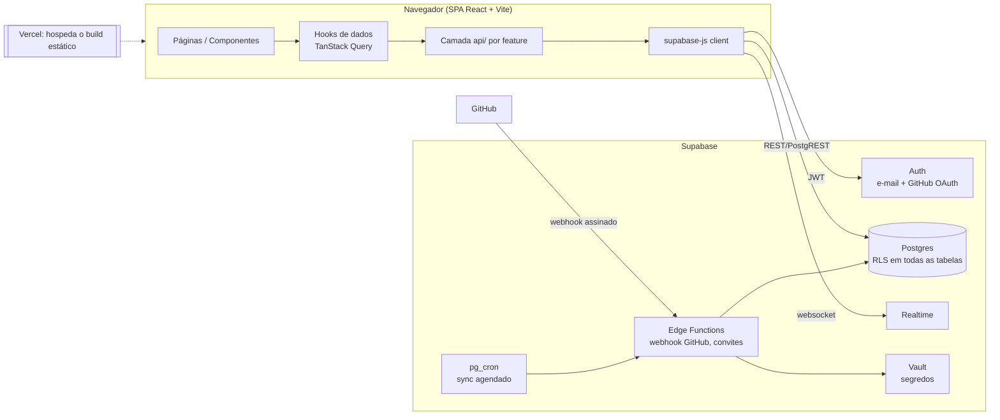
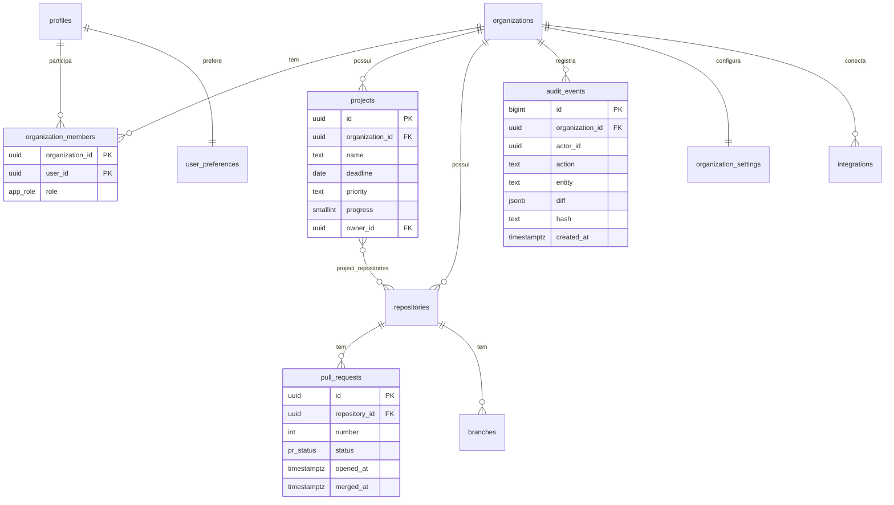
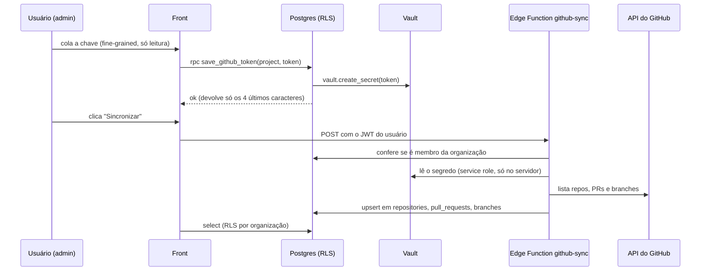

# GovTech MS — Plano Técnico (Back-end Supabase, Refatoração, Testes, Responsividade)

> **Status (01/11/2026):** ✅ Limpeza (branch `chore/limpeza`) · ✅ Qualidade: ESLint, Prettier e Husky (branch `chore/qualidade`) · ✅ Skills instaladas · ✅ Testes P0 (branch `test/setup`, §14) · Supabase `govtech-br` em São Paulo, vazio.
>
> Autor: Tech Lead (IA) · Data: 31/10/2026 · Base: commit `193c764` (branch `main`)

## Índice

1. [Diagnóstico crítico do estado atual](#1-diagnóstico-crítico-do-estado-atual)
2. [Questionamentos ao time (precisam de resposta)](#2-questionamentos-ao-time-precisam-de-resposta)
3. [Arquitetura alvo](#3-arquitetura-alvo)
4. [Back-end com Supabase](#4-back-end-com-supabase)
5. [Refatoração do front-end](#5-refatoração-do-front-end)
6. [Estratégia de testes](#6-estratégia-de-testes)
7. [Roadmap de responsividade](#7-roadmap-de-responsividade)
8. [Roadmap consolidado (ordem de execução)](#8-roadmap-consolidado-ordem-de-execução)
9. [Skills e ferramentas de IA recomendadas](#9-skills-e-ferramentas-de-ia-recomendadas)
10. [Baixo consumo de tokens, alta entrega](#10-baixo-consumo-de-tokens-alta-entrega)
11. [Checklist de aprovação](#11-checklist-de-aprovação)
12. [Referências](#12-referências)
13. [Qualidade: lint e formatação](#13-qualidade-lint-e-formatação--aprovado-e-aplicado-em-31102026)
14. [Testes](#14-testes--aprovado-e-aplicado-em-01112026)

---

## 1. Diagnóstico crítico do estado atual

### O que está bom
- **Regras de negócio isoladas** em `utils/projectUtils.js` (funções puras, fáceis de testar).
- **Design tokens** em `tokens.css` com tema claro/escuro: boa base para um design system.
- **Defensividade** no `normalizeProject` e nos `try/catch` de storage.
- **Deploy simples** na Vercel com rewrite de SPA correto.

### O que está ruim (e por que importa)

| # | Problema | Evidência | Impacto | Prioridade |
|---|---|---|---|---|
| 1 | **Duas arquiteturas de navegação convivendo** | `App.jsx` (rotas) e `pages/DashboardPage.jsx` (estado `active` + `switch`) | Duas sidebars na Visão geral, dois estados de projetos e duas lógicas de tema. Bug garantido ao plugar o back-end | 🔴 |
| 2 | **Persistência gravando na chave `"undefined"`** | `utils/storageUtils.js` usa `STORAGE_KEYS.projects` (minúsculo) | Dados "funcionam" por acidente | 🔴 |
| 3 | **Filtros por campo inexistente** | `ProjectsPage.jsx:168,174` filtra `p.status`, que o `normalizeProject` descarta | Indicadores "Em atenção" e "Riscos críticos" ficam sempre em 0 | 🔴 |
| 4 | **Sem autenticação nem proteção de rota** | `useState(true)` em `App.jsx:57` | Inaceitável num produto de *governança* | 🔴 |
| 5 | **Sem `src/`, lint, formatter ou testes** | raiz do repo, `package.json` só tem dev/build/preview | Nenhuma rede de segurança para refatorar | 🔴 |
| 6 | **~330 estilos inline** + 2 CSS globais de ~1.500 linhas cada | `grep "style={{"` | Responsividade inviável (inline não aceita media query), CSS sem escopo | 🟠 |
| 7 | **10 breakpoints diferentes** (390, 640, 760, 768, 900, 1024, 1100…) | `app.css`, `index.css` | Layout inconsistente entre telas | 🟠 |
| 8 | **Mocks dentro dos componentes** e valores fixos ("4.2 dias", "92%") | `OverviewPage`, `AuditPage`, `RbacPage` | Dado falso disfarçado de métrica | 🟠 |
| 9 | **Código morto** (8 arquivos, 3 com 0 linhas) | ver `DOCUMENTACAO.md §16` | Ruído para humanos e para a IA (gasta tokens) | 🟡 |
| 10 | **`console.log` de debug** imprimindo a lista inteira a cada render | `ProjectsPage.jsx:53-58,88` | Ruído e vazamento de dados no console | 🟡 |
| 11 | **Histórico git reescrito** (1 commit) e `DOCUMENTACAO.md` citando commit/caminho antigos (`8ed3a40`, `govtech-ms`) | `git log` | Documentação desatualizada; perda de rastreabilidade | 🟡 |
| 12 | **Trabalho direto na `main`** | 1 branch | Sem revisão; contradiz a proposta do próprio produto (governança de PRs) | 🟡 |

**Situação em 31/10/2026:**
- ✅ Resolvidos na limpeza: #1, #2, #3 (status manual), #8 (mocks centralizados em `data/`; continuam mocks, por decisão), #9, #10, #11, #12 (trabalho na branch `chore/limpeza`). Bônus: o `App.jsx` não salvava os projetos; agora salva.
- ⏸️ #4 (auth/rotas): adiado pelo time, entra com o Supabase.
- 📝 #5 (lint/formatação): proposta na §13, **aguardando aprovação**.
- 🗓️ #6 e #7 (estilos inline e breakpoints): fase **Nova estrutura**.

> **Leitura de Tech Lead:** o produto *vende governança, rastreabilidade e controle de acesso*, mas o código não pratica nenhum dos três. Para a banca do TCC esse é o ponto mais vulnerável, e por isso **autenticação + RLS + auditoria real** são a espinha do plano.

---

## 2. Questionamentos ao time (respondidos em 31/10/2026)

| # | Pergunta | Decisão do time | Consequência no plano |
|---|---|---|---|
| Q1 | Data de entrega | **18/11/2026** (18 dias) | Roadmap recortado (§8). GitHub real, Realtime, CSV e chatbot com IA ficam fora |
| Q2 | Multi-organização? | **Sim**. Projeto Supabase **`govtech-br`** (ref `dulcrbaxzcmfgoikvocl`, região `sa-east-1` São Paulo, por LGPD e latência). O antigo `govtech` (`us-east-1`) foi apagado | Fase Supabase começa direto pelas migrations |
| Q3 | Cadastro aberto ou convite? | **Cadastro aberto** | No cadastro o usuário escolhe: **criar organização** (informa o nome da empresa e vira admin) ou **entrar com o código da organização** (entra como `viewer`; o admin promove). Ver §4.3 |
| Q4 | Auth/proteção de rotas | **Ver depois** | Entra junto com o Supabase |
| Q5 | TypeScript? | **Não** | Fica JavaScript. zod valida dados nas bordas |
| Q6 | Status do projeto | **Manual** | ✅ Já implementado (`constants/projectStatus.js`). O semáforo de prazo continua como informação separada |
| Q7 | Auditoria | **Só para revisão** | Log simples por trigger, sem cadeia de hash |
| Q8 | Dados pessoais | **Nome, e-mail e chave de API do GitHub**. A chave **entra no escopo até 18/11**: "sem ela o projeto não avança" | Ver §4.7: chave no Vault + Edge Function `github-sync` que busca repositórios, PRs e branches sob demanda |
| Q9 | Chatbot com IA | **A definir** | Fora do escopo até 18/11 |
| Q10 | Landing page | **Fica, em pastas separadas**; o botão de login chama o sistema | `frontend/src/landing/` separado de `frontend/src/app/` |
| Q11 | Pausa do Supabase Free | **Ok** | Reativar na véspera da defesa |
| Q12 | Pessoas no projeto | **2** | Branch por tarefa + PR revisado pelo colega |
| Q13 | Fórmulas dos KPIs | **Pode deixar** | Números fixos ficam até haver dados reais |
| — | Separar back e front | **Sim, pastas diferentes** | `frontend/` e `backend/` na raiz (§5.1) |
| — | Repositório remoto | **GitHub** `oguilhermekenzo/govtech` (privado), já conectado como `origin` | Subir as branches e abrir PRs para a `main` |
| — | Chave do GitHub | **Uma por projeto**, cadastrada pelo admin | Ver §4.7 |
| — | Lint, Husky, skills, arquitetura, estrutura, testes, roadmap | **Aprovados** | Executados: Qualidade e skills. Próxima: Testes (§14) |

## 3. Arquitetura alvo



**Princípios:**
1. **O banco é a fronteira de segurança.** O front esconde botões por conveniência; quem *impede* é a RLS.
2. **Nenhum segredo no front.** O browser só conhece a *publishable key* (`sb_publishable_…`). A *secret key* (`sb_secret_…`, antiga `service_role`) só existe em Edge Functions.
3. **Schema como código.** Toda mudança de banco é uma *migration* versionada no git, nunca um clique no dashboard de produção.
4. **Front desacoplado do provedor.** Componentes não importam `supabase` diretamente; passam por `features/*/api`. Isso também facilita os testes.

---

## 4. Back-end com Supabase

### 4.1 Serviços do Supabase que vamos usar

| Serviço | Uso no GovTech | Fase |
|---|---|---|
| **Postgres + PostgREST** | Todas as entidades | 3 |
| **Auth** | Login e-mail/senha, convite por e-mail; depois GitHub OAuth | 3 |
| **RLS** | RBAC real por organização | 3 |
| **Triggers + funções** | Auditoria automática, `updated_at`, criação de `profile` | 3 |
| **Views** | KPIs (lead time, taxa de aprovação, status de projetos) | 4 |
| **Edge Functions** (Deno) | Webhook do GitHub, convite de usuários, export CSV | 5 |
| **Vault** | Token do GitHub App | 5 |
| **Realtime** | Feed de atividade e alertas ao vivo (opcional) | 6 |
| **pg_cron** | Sync periódico com GitHub e ping anti-pausa | 5 |

### 4.2 Modelo de dados (proposta)



Mapeamento a partir do mock atual (`data/mockData.js`):

| Mock atual | Tabela | Observação |
|---|---|---|
| `profile` | `profiles` | 1:1 com `auth.users`, criado por trigger |
| `services` | `repositories` | `deploy`, `team` e `language` viram colunas |
| `projects` | `projects` + `project_repositories` | `repositories: string[]` vira tabela N:N |
| `pullRequests` / `branches` | `pull_requests` / `branches` | Alimentados pelo GitHub (fase 5) ou seed |
| `auditEvents` | `audit_events` | Escrito **só por trigger**, nunca pelo cliente |
| `accessRoles` | enum `app_role` + `organization_members` | Admin, Developer, Stakeholder, Viewer |
| `settings` (localStorage) | `organization_settings` + `user_preferences` | Tema é preferência do usuário; fuso é da organização |
| `repoStats`, "4.2 dias", "92%" | mantidos como mock (Q13) | Viram views SQL depois do TCC |
| chave de API do GitHub (Q8) | `github_credentials` (guarda só o id do segredo) + **Vault** | Lida apenas por Edge Function; o dono pode cadastrar/apagar, ninguém lê o valor pelo front |

### 4.3 Esboço SQL (primeira migration)

```sql
-- supabase/migrations/<timestamp>_core_schema.sql
create type public.app_role as enum ('admin', 'developer', 'stakeholder', 'viewer');

create table public.organizations (
  id uuid primary key default gen_random_uuid(),
  name text not null,
  slug text not null unique,
  -- código para entrar na organização no cadastro (aleatório, o admin pode gerar outro)
  join_code text not null unique default upper(substr(md5(gen_random_uuid()::text), 1, 8)),
  created_at timestamptz not null default now()
);

create table public.profiles (
  id uuid primary key references auth.users (id) on delete cascade,
  full_name text,
  avatar_url text,
  created_at timestamptz not null default now()
);

create table public.organization_members (
  organization_id uuid not null references public.organizations (id) on delete cascade,
  user_id uuid not null references public.profiles (id) on delete cascade,
  role public.app_role not null default 'viewer',
  primary key (organization_id, user_id)
);
create index on public.organization_members (user_id);

create table public.projects (
  id uuid primary key default gen_random_uuid(),
  organization_id uuid not null references public.organizations (id) on delete cascade,
  name text not null check (char_length(name) between 1 and 120),
  description text,
  deadline date,
  owner_id uuid references public.profiles (id),
  priority text not null default 'medium' check (priority in ('high', 'medium', 'low')),
  progress smallint not null default 0 check (progress between 0 and 100),
  created_by uuid default auth.uid() references public.profiles (id),
  created_at timestamptz not null default now(),
  updated_at timestamptz not null default now()
);
create index on public.projects (organization_id);

-- Funções auxiliares de RLS ficam num schema NÃO exposto pela API
create schema if not exists private;

create function private.has_org_role(org uuid, roles public.app_role[])
returns boolean
language sql stable security definer set search_path = ''
as $$
  select exists (
    select 1 from public.organization_members m
    where m.organization_id = org
      and m.user_id = (select auth.uid())
      and m.role = any (roles)
  );
$$;

alter table public.projects enable row level security;

create policy "membros leem projetos" on public.projects
  for select to authenticated
  using (private.has_org_role(organization_id,
         array['admin','developer','stakeholder','viewer']::public.app_role[]));

create policy "admin/dev criam projetos" on public.projects
  for insert to authenticated
  with check (private.has_org_role(organization_id,
              array['admin','developer']::public.app_role[]));

create policy "admin/dev editam projetos" on public.projects
  for update to authenticated
  using (private.has_org_role(organization_id, array['admin','developer']::public.app_role[]))
  with check (private.has_org_role(organization_id, array['admin','developer']::public.app_role[]));

create policy "só admin exclui projetos" on public.projects
  for delete to authenticated
  using (private.has_org_role(organization_id, array['admin']::public.app_role[]));
```

**Regras de RLS que valem para todas as tabelas:**
- `enable row level security` em **toda** tabela do schema `public`, sem exceção.
- Usar `(select auth.uid())` (com `select`) nas policies, pois o Postgres avalia uma vez por query, não por linha.
- Indexar toda coluna usada em policy (`organization_id`, `user_id`).
- Funções `security definer` sempre com `set search_path = ''` e em schema `private`.
- `audit_events`: só policy de `select`. Nenhuma de `insert/update/delete` para `authenticated`; quem escreve é o trigger.
- RLS sem policy devolve `[]` **sem erro**. Todo "a lista veio vazia" deve começar a investigação pelas policies.
- Rodar o **Security Advisor** (`get_advisors`) a cada migration.

**Cadastro e entrada na organização (Q3):** a tela de cadastro tem duas opções.
- **Criar organização:** informa o nome da empresa; a `rpc create_organization(name)` cria a organização e o vínculo como `admin`.
- **Entrar com código:** informa o `join_code`; a `rpc join_organization(code)` (`security definer` em `private`) cria o vínculo como `viewer`. O admin promove depois na tela de RBAC e pode gerar um código novo se ele vazar.
- Entrar **só pelo nome** da empresa não é seguro (qualquer pessoa entraria em qualquer organização); o nome serve para criar e para exibir.

### 4.4 Auditoria (simples, para revisão — Q7)

Trigger genérico `private.audit_row()` em `projects`, `organization_members` e `repositories` grava `action` (`INSERT/UPDATE/DELETE`), `entity`, `entity_id`, `actor_id = auth.uid()`, `diff` (jsonb `old`/`new`) e `created_at`. Sem cadeia de hash. A tela de Auditoria passa a listar esses eventos no lugar do mock.

### 4.5 Ambiente e fluxo de trabalho

```
backend/supabase/
├── config.toml
├── migrations/          ← SQL versionado (fonte da verdade)
├── seed.sql             ← dados de demo (vindos de data/mockData.js)
├── functions/           ← Edge Functions (Deno/TS)
│   ├── github-webhook/
│   └── invite-member/
└── tests/               ← pgTAP: testes de RLS
```

| Etapa | Comando | Observação |
|---|---|---|
| Instalar CLI | `npm i -D supabase` | Versão fixada por projeto |
| Subir stack local (Docker) | `npx supabase start` | Postgres, Auth e Studio locais |
| Nova migration | `npx supabase migration new core_schema` | |
| Recriar banco local + seed | `npx supabase db reset` | Rodar a cada mudança |
| Testar RLS | `npx supabase test db` | pgTAP |
| Aplicar no remoto | `npx supabase db push` | **Só via CI** depois de configurado |

**Ambientes:** `local` (Docker) → `staging` (projeto Supabase de teste, preview da Vercel) → `production`. Variáveis na Vercel: `VITE_SUPABASE_URL` e `VITE_SUPABASE_PUBLISHABLE_KEY`. Criar `.env.example` versionado; `.env.local` já está no `.gitignore`.

### 4.6 Integração no front (contrato)

```js
// src/shared/lib/supabase.js — único lugar que cria o client
import { createClient } from '@supabase/supabase-js'
export const supabase = createClient(
  import.meta.env.VITE_SUPABASE_URL,
  import.meta.env.VITE_SUPABASE_PUBLISHABLE_KEY,
)

// src/features/projects/api/projectsApi.js — snake_case do banco vira camelCase aqui
export async function listProjects(organizationId) {
  const { data, error } = await supabase
    .from('projects')
    .select('id, name, description, deadline, priority, progress, owner:profiles(full_name), project_repositories(repository_id)')
    .eq('organization_id', organizationId)
    .order('deadline')
  if (error) throw error
  return data.map(toProject)
}

// src/features/projects/hooks/useProjects.js — cache, loading e erro via TanStack Query
export const useProjects = (orgId) =>
  useQuery({ queryKey: ['projects', orgId], queryFn: () => listProjects(orgId) })
```

- **Auth:** `AuthProvider` (contexto) escuta `supabase.auth.onAuthStateChange`; `<ProtectedRoute>` redireciona para `/login`; `<Can role="admin">` esconde ações na UI.
- **Estado de servidor** (projetos, PRs…) fica no TanStack Query. **Estado de UI** (modal aberto, aba) fica em `useState`. **Preferências** ficam em `user_preferences`, com `localStorage` só como cache de tema para evitar o "flash" ao carregar.
- **Transição sem big-bang:** na fase 2 a camada `api/` é criada *ainda usando localStorage*. Na fase 3 só o corpo dessas funções muda; páginas e testes de componente ficam intactos.

---

### 4.7 Integração com o GitHub via chave de API (no escopo até 18/11)

Sem webhook nem GitHub App (não cabem no prazo): sincronização **sob demanda**, por um botão "Sincronizar" na tela de Repositórios.



- **Tipo de chave:** *fine-grained personal access token*, só leitura (Metadata, Contents e Pull requests), restrito aos repositórios necessários.
- **Uma chave por projeto** (decisão de 01/11): cada projeto aponta para repositórios que podem ser de donos diferentes no GitHub.
- **Onde fica:** `vault.secrets`, criptografada. A tabela `github_credentials(project_id primary key, organization_id, secret_id, token_last4, created_by, created_at)` guarda só a referência (`organization_id` repetido para a policy de RLS, com índice). Nenhuma policy permite ao front ler o segredo.
- **Quem pode:** só o admin da organização cadastra, troca ou remove a chave de um projeto (`rpc save_github_token(project_id, token)`). Qualquer membro vê os dados sincronizados. A sincronização (`github-sync`) recebe o `project_id`.
- **Validação:** ao salvar, a Edge Function chama `GET /user` no GitHub para confirmar que a chave funciona antes de guardar.

## 5. Refatoração do front-end

### 5.1 Estrutura alvo: back e front separados

```
govtech/
├── frontend/                  ← app React + Vite (tudo que roda no navegador)
│   ├── package.json
│   ├── vite.config.js
│   ├── index.html
│   ├── public/                ← favicon etc.
│   └── src/
│       ├── main.jsx
│       ├── landing/           ← página institucional (Q10), separada do sistema
│       ├── app/               ← o sistema: App.jsx, router.jsx, providers/
│       ├── features/
│       │   ├── auth/          ← LoginPage, cadastro, AuthProvider, ProtectedRoute
│       │   ├── dashboard/
│       │   ├── projects/      ← api/, hooks/, components/, utils/, __tests__/
│       │   ├── repositories/
│       │   ├── audit/
│       │   ├── rbac/
│       │   └── settings/
│       ├── shared/            ← ui/, layout/, hooks/, lib/ (supabase.js), constants/
│       ├── mocks/             ← mockData.js (continua sendo a fonte até o Supabase)
│       ├── styles/            ← tokens.css, reset.css, global.css
│       └── test/              ← setup.js, msw/, utils/
├── backend/
│   └── supabase/              ← config.toml, migrations/, seed.sql, functions/, tests/
├── docs/
├── .gitattributes / .editorconfig
└── README.md
```

- A Vercel passa a usar **Root Directory = `frontend`**, e o `vercel.json` vai para dentro de `frontend/`.
- O CLI do Supabase roda a partir de `backend/` (`npx supabase <comando> --workdir backend`).
- `landing/` e `app/` não importam um do outro. O botão "Entrar" da landing só navega para `/login`.

**Regras de dependência** (verificáveis com `eslint-plugin-boundaries` ou revisão):
- `features/A` **não importa** de `features/B`. O que é compartilhado sobe para `shared/`.
- `shared/` não importa de `features/`.
- Só `features/*/api` importa `shared/lib/supabase`.

### 5.2 Decisões técnicas

| Tema | Decisão | Alternativa descartada | Por quê |
|---|---|---|---|
| Estilo | **CSS Modules** + tokens existentes | Tailwind | Zero dependência nova, reaproveita `tokens.css`, resolve escopo e permite media query (inline não permite) |
| Roteamento | Rotas **aninhadas** com `<Outlet>` + `lazy()` | 6 rotas renderizando o mesmo layout + `switch` | Remove a duplicação do `DashboardPage`; code-splitting da Landing (655 linhas) |
| Estado servidor | **TanStack Query v5** | `useEffect` + `useState` manual | Cache, retry, loading/erro e invalidação prontos |
| Formulários | **react-hook-form + zod** | estado manual | Validação declarativa; o mesmo schema zod valida a resposta da API |
| Toast | `ToastProvider` + `useToast()` | prop `onToast` repassada em cascata | Elimina *prop drilling* |
| Ícones | Importar o componente Lucide direto | `Icon name="..."` com mapa de strings | Erro de digitação vira erro de build, não ícone silencioso; tree-shaking |
| Qualidade | **ESLint** (react, react-hooks, jsx-a11y, import) + **Prettier** + **Husky/lint-staged** | — | Pré-requisito para refatorar com segurança |
| Linguagem | **JavaScript** (Q5) | TypeScript | Decisão do time; zod valida dados nas bordas (formulários e respostas da API) |

### 5.3 Componentes do design system (`shared/ui`)

Extraídos do que já se repete no código:

| Componente | Substitui |
|---|---|
| `Button` (variants: primary, secondary, ghost, danger; sizes) | dezenas de `<button style={{...}}>` |
| `Card` / `Panel` | `.panel`, `.metric-card` |
| `StatCard` | já existe, só ganha CSS Module |
| `Badge` | `StatusBadge` + selos inline |
| `Modal` | `ModalShell`, com foco preso, `Esc`, `aria-modal`, e *sheet* no mobile |
| `Tabs` | abas de Repositórios e Configurações |
| `DataTable` / `ResponsiveList` | tabelas de RBAC, Auditoria e PRs (vira cards no mobile) |
| `EmptyState`, `Skeleton`, `ErrorState` | estados ausentes hoje (necessários com back-end) |
| `ProgressBar`, `Switch`, `Field` | Projetos e Configurações |

### 5.4 Ordem segura da refatoração

1. **Faxina** (sem mudar comportamento): remover código morto, `console.log`, imports não usados; corrigir as chaves de storage.
2. **Rede de segurança:** ESLint, Prettier, Vitest, e **testes de caracterização** em `projectUtils`, `storageUtils` e no fluxo de Projetos *antes* de mover arquivos.
3. **Mover para `src/`** com alias `@/` no `vite.config.js` (commit só de movimentação, sem mudar código).
4. **Unificar navegação:** rotas aninhadas, apagar `DashboardPage` e `DashboardLayout`, centralizar o tema num `ThemeProvider`.
5. **Extrair `shared/ui`** e migrar inline → CSS Modules, uma feature por PR.
6. **Mover mocks** de dentro dos componentes para `api/` (ainda locais), preparando a fase do Supabase.

Cada passo = 1 PR pequeno, com CI verde. Nunca misturar "mover arquivo" com "mudar lógica" no mesmo commit.

---

## 6. Estratégia de testes

Detalhamento completo, com a lista de casos, em [`docs/TESTES.mmd`](./TESTES.mmd).

**Modelo: Testing Trophy** (Kent C. Dodds). A maior parte do valor está nos testes de **integração de componente** (renderizar a página e interagir como usuário), apoiados por análise estática e unitários das regras puras, com poucos E2E críticos.

| Camada | Ferramenta | O que cobre | Meta |
|---|---|---|---|
| Estática | ESLint, Prettier, (TS) | Erros de digitação, hooks, a11y | 0 erros no CI |
| Unitário | **Vitest** | `projectStatus`, `normalizeProject`, formatadores, mappers da API, hooks | ≥ 90% de linhas em `utils/` e `api/` |
| Integração de componente | **Vitest + React Testing Library + user-event + jest-dom** | Páginas e modais, com rede mockada | Todos os fluxos de §6 do `.mmd` |
| Mock de rede | **MSW v2** | Intercepta as chamadas REST do supabase-js | `onUnhandledRequest: 'error'` |
| Banco / RLS | **pgTAP** (`supabase test db`) | Cada policy, positiva e negativa | 1 teste por papel × operação × tabela |
| E2E | **Playwright** | Login → CRUD de projeto → logout; RBAC; 3 viewports | ≤ 10 cenários, rodando no CI |
| Acessibilidade | `vitest-axe` / `@axe-core/playwright` | Violações WCAG 2.2 AA | 0 violações sérias |

**Convenções:**
- Testar **comportamento**, não implementação: buscar por `getByRole`/`getByLabelText`, nunca por classe CSS.
- Datas: `vi.useFakeTimers()` + `vi.setSystemTime()`. O semáforo de prazo depende de "hoje"; sem isso o teste quebra sozinho com o passar do tempo.
- Arquivo de teste ao lado do código (`__tests__/` na feature).
- `renderWithProviders()` único (Router + QueryClient + Auth fake + Toast).
- Cobertura é sinal, não meta: o CI barra apenas abaixo de 70% global e 90% em `utils/`.

Scripts propostos no `package.json`:
```json
"test": "vitest",
"test:run": "vitest run",
"test:coverage": "vitest run --coverage",
"test:e2e": "playwright test",
"test:db": "supabase test db",
"lint": "eslint .",
"format": "prettier --write ."
```

**CI (GitHub Actions)** em todo PR: `lint` → `test:run --coverage` → `build` → (com Supabase) `supabase db reset && supabase test db` → `test:e2e` contra o preview da Vercel.

---

## 7. Roadmap de responsividade

### 7.1 Princípios
- **Mobile-first:** estilo base para 360px; `min-width` para crescer.
- **Um conjunto de breakpoints**, em tokens (substitui os 10 atuais):

| Token | Largura | Alvo |
|---|---|---|
| `--bp-sm` | 640px | celular grande / paisagem |
| `--bp-md` | 768px | tablet retrato |
| `--bp-lg` | 1024px | tablet paisagem / notebook pequeno — **sidebar fixa a partir daqui** |
| `--bp-xl` | 1280px | desktop |

> Variáveis CSS não funcionam dentro de `@media`. Os valores ficam documentados em `tokens.css` e são usados literalmente, ou via `@custom-media` com PostCSS (opcional).

- **Container queries** (`@container`) para cards e painéis que mudam de layout conforme o espaço do *painel*, não da tela.
- **Tipografia e espaçamento fluidos** com `clamp()`.
- **Alvos de toque ≥ 44×44px**; WCAG 2.2 (2.5.8) exige no mínimo 24×24.
- Respeitar `prefers-reduced-motion`.

### 7.2 Fases

| Fase | Entrega | Critério de pronto |
|---|---|---|
| **R0 — Auditoria** | Screenshots de todas as telas em 360, 390, 768, 1024, 1440; lista de quebras | Planilha de issues por tela |
| **R1 — Fundação** | Tokens de breakpoint, `clamp()`, reset, `useMediaQuery`; fim dos estilos inline nas telas críticas | 0 scroll horizontal em 360px |
| **R2 — Shell** | Sidebar vira *drawer* abaixo de `lg` (com foco preso e `Esc`); Topbar compacta; GlobalSearch em tela cheia no mobile | Navegar todas as rotas no celular |
| **R3 — Conteúdo** | Grids de KPI `auto-fit/minmax`; gráficos SVG com `viewBox` e `width: 100%`; **tabelas viram lista de cards** abaixo de `md` (RBAC, Auditoria, PRs) | Nenhuma informação escondida ou cortada |
| **R4 — Interação** | Modais viram *bottom sheet*/tela cheia no mobile; formulários em 1 coluna; teclado virtual não cobre o botão "Salvar" | Fluxo de criar projeto completo no celular |
| **R5 — Verificação** | Playwright com 3 projetos (mobile/tablet/desktop) + screenshots; Lighthouse mobile ≥ 90 em Performance e Acessibilidade | CI verde nos 3 viewports |

Ordem das telas (impacto × uso): Login → Shell → Visão geral → Projetos → Repositórios → Auditoria → RBAC → Configurações → Landing.

---

## 8. Roadmap consolidado (ordem de execução)

Ordem definida pelo time: **limpeza → qualidade → testes → nova estrutura → Supabase**. Prazo: **18/11/2026**, 2 devs.

> ⚠️ **Alerta de Tech Lead:** o roadmap original completo (≈ 21 semanas para 1 dev) não cabe em 18 dias. O recorte abaixo prioriza o que a banca vai cobrar: **login real, dados persistidos com RLS por organização e código organizado e testado**. O que ficou de fora entra como "trabalhos futuros" no texto do TCC.

| Fase | Datas | Escopo | Pronto quando |
|---|---|---|---|
| ✅ **Limpeza** | 31/10 | Itens #1–3 e #8–12 do diagnóstico | Build ok; verificado no navegador |
| ✅ **Qualidade** | 31/10 | ESLint 9 + Prettier + Husky/lint-staged + LF; 0 erros (17 avisos de acessibilidade ficam para a nova estrutura) | `npm run lint` sem erros |
| **Testes** | 01–04/11 | Vitest + RTL (§14); casos **P0** do `TESTES.mmd`; CI no GitHub Actions | ~30 testes verdes no CI |
| **Nova estrutura** (Dev A) | 04–10/11 | `frontend/` + `backend/`; `src/` por feature; landing separada; rotas aninhadas; CSS Modules e breakpoints únicos nas telas críticas | Testes P0 verdes; sem scroll horizontal em 390px nessas telas |
| **Supabase: base** (Dev B, em paralelo) | 04–09/11 | Migrations (orgs, membros, profiles, projects, audit), RLS, Auth com cadastro, seed | Testes pgTAP de RLS verdes |
| **Supabase: integração** | 10–14/11 | Front lendo e gravando no banco; chave do GitHub no Vault; Edge Function `github-sync`; Repositórios com dados reais | Cadastro → login → CRUD de projeto → sincronizar GitHub, em produção |
| **Folga** | 15–17/11 | Correções, deploy final, roteiro da demo | Demo ensaiada |
| 🎓 **Defesa** | 18/11 | — | — |

**Divisão sugerida para 2 devs** (a partir de "Nova estrutura"): Dev A no front (estrutura, CSS, telas) e Dev B no back (Supabase, migrations, RLS). Os dois se encontram na camada `features/*/api`.

**Fora do escopo até 18/11:** webhook e GitHub App (a sincronização é sob demanda, §4.7), Realtime, export CSV, convites, chatbot com IA, E2E completo com Playwright e responsividade das telas secundárias (Repositórios, Auditoria, RBAC, Configurações).

## 9. Skills e ferramentas de IA recomendadas

Pesquisadas com a skill **find-skills** (`npx skills find …`, catálogo [skills.sh](https://skills.sh/)). **Nenhuma foi instalada.** Aguardam sua aprovação.

| Skill | Fonte / instalações | Para quê | Comando |
|---|---|---|---|
| `supabase` | supabase/agent-skills (oficial) · 351.8K | Guia geral, segurança, Auth e RLS. Recomendada pelo próprio MCP do Supabase | `npx skills add supabase/agent-skills@supabase` |
| `supabase-postgres-best-practices` | supabase/agent-skills (oficial) · 468.2K | Schema, índices, performance de RLS | `npx skills add supabase/agent-skills@supabase-postgres-best-practices` |
| `vercel-react-best-practices` | vercel-labs (oficial) · 857.4K | Performance e padrões React. *Parte é focada em Next.js; usar só o que se aplica a SPA* | `npx skills add vercel-labs/agent-skills@vercel-react-best-practices` |
| `vercel-composition-patterns` | vercel-labs (oficial) · 429.5K | Componentização (compound components, composição) para o `shared/ui` | `npx skills add vercel-labs/agent-skills@vercel-composition-patterns` |
| `vitest` | antfu/skills · 45.3K | Autor do Vitest/Vite; configuração e padrões | `npx skills add antfu/skills@vitest` |
| `adapt` | pbakaus/impeccable · 81.7K | Adaptar UI a múltiplos viewports (fases R) | `npx skills add pbakaus/impeccable@adapt` |
| `claude-md-improver` | anthropics/claude-plugins-official · 13.3K | Manter o CLAUDE.md/AGENTS.md enxuto | `npx skills add anthropics/claude-plugins-official@claude-md-improver` |

**Já disponíveis nesta máquina e úteis aqui:** `superpowers:test-driven-development`, `superpowers:writing-plans`, `superpowers:systematic-debugging`, `frontend-design`, `andrej-karpathy-skills:karpathy-guidelines`, `code-review`, `security-review`. O conector **Supabase MCP** também já está ligado (migrations, advisors, geração de tipos).

> Instalar **por projeto** (sem `-g`) para o time compartilhar a mesma versão. Antes de instalar, revisar o `SKILL.md` de cada uma: skill é instrução executada pela IA, então é superfície de ataque (*supply chain*).

---

## 10. Baixo consumo de tokens, alta entrega

### 10.1 O que já mudei na proposta para economizar
- **`AGENTS.md` curto (≈100 linhas)** na raiz ([`AGENTS.md`](../AGENTS.md)). Ele é lido **em toda mensagem**: cada linha custa tokens para sempre. Detalhes ficam em docs linkados e só são lidos quando necessário (*progressive disclosure*).
- **Apagar código morto** (F0) também economiza: a IA para de ler e raciocinar sobre arquivos que não importam.
- **Estrutura por feature:** uma tarefa em "projetos" pede para ler 1 pasta, não o repo inteiro.

### 10.2 Hábitos que mais fazem diferença (do maior para o menor impacto)

| # | Hábito | Por quê |
|---|---|---|
| 1 | **`/clear` ao trocar de assunto.** Uma conversa = uma tarefa | Todo o histórico é reenviado a cada mensagem; contexto velho é custo puro |
| 2 | **Escolher o modelo pela tarefa** (`/model`): Sonnet/Haiku para tarefas rotineiras (renomear, escrever testes de um padrão já definido, CSS); Opus para arquitetura e bugs difíceis | Diferença de custo de várias vezes por token |
| 3 | **Planejar antes de executar** (Plan mode / pedir "só o plano") | Corrigir um plano custa centenas de tokens; desfazer código custa milhares |
| 4 | **Prompts com endereço:** "em `@pages/ProjectsPage.jsx` linhas 160–180, o contador X…" e não "a página de projetos está estranha" | Evita a IA varrer o projeto para achar o lugar |
| 5 | **Critério de pronto no prompt:** "pronto quando `npm run test:run` passar" | A IA para no ponto certo, sem idas e vindas |
| 6 | **`/compact <foco>` cedo**, não quando o contexto já está cheio. Ex.: `/compact manter só decisões do schema` | Resumo guiado preserva o que importa |
| 7 | **`/context` e `/usage`** para ver onde os tokens estão indo | Medir antes de otimizar |
| 8 | **Desligar plugins/MCPs que não são deste projeto.** Hoje sua sessão carrega descrições de Gmail, Gamma, Notion, Vercel (~200 ferramentas), HyperFrames/Remotion (vídeo) etc. | Cada skill/ferramenta listada ocupa contexto em toda sessão. Para este repo bastam Supabase e, talvez, Vercel |
| 9 | **Não colar logs inteiros:** colar o erro + 10 linhas, ou pedir para a IA rodar `npm test 2>&1 \| tail -30` | Logs são os maiores "comedores" de contexto |
| 10 | **Pedir respostas curtas quando basta:** "responda em até 5 linhas", "só o diff" | Saída também é token (e mais cara que entrada) |
| 11 | **Subagentes para explorações amplas** ("ache todos os usos de X") | O resultado volta resumido e o contexto principal fica limpo. Use com moderação: subagente também consome |
| 12 | **Bloquear leitura de pastas inúteis** em `.claude/settings.json` | Evita leituras acidentais de `dist/` e `node_modules/` |

```json
// .claude/settings.json (proposta)
{
  "permissions": {
    "deny": ["Read(./node_modules/**)", "Read(./dist/**)", "Read(./package-lock.json)"]
  }
}
```

### 10.3 Feedback direto sobre o seu prompt de hoje
- ✅ **Bom:** pediu tudo de uma vez (uma única leitura do código serviu para tudo), deu o papel ("Tech Lead") e exigiu aprovação.
- ⚠️ **Melhorável:** faltou dizer **prazo do TCC**, **quem lê** os documentos (você, a banca, o time?) e **formato/tamanho esperado**. Isso me obrigou a assumir escopo. Um template rápido:

```
Contexto: <1 linha>     Objetivo: <resultado verificável>
Arquivos: @a @b         Restrições: <o que não mudar>
Pronto quando: <teste/comando>   Formato: <tamanho/estilo da resposta>
```

---

## 11. Checklist de aprovação

- [x] **A.** Respostas Q1–Q13 (§2)
- [x] **Limpeza**: itens 1, 2, 3, 8, 9, 10, 11 e 12 aplicados
- [x] **Qualidade**: lint, formatação e Husky (§13), aplicados
- [x] **Testes**: dependências, configuração, CI e testes P0 (§14)
- [x] **Bug do prazo** (§14.5): `getProjectStatus` corrigido
- [x] **B/C.** Arquitetura e modelo de dados ajustados às decisões (§3–§4)
- [x] **E.** Estrutura `frontend/` + `backend/` (§5.1)
- [x] **G.** Stack e metas de testes (§6 + `TESTES.mmd`)
- [x] **H.** Responsividade recortada às telas críticas (§7 e §8)
- [x] **I.** Roadmap com prazo de 18/11 (§8)
- [x] **J.** Skills instaladas no projeto: `supabase`, `supabase-postgres-best-practices`, `vitest`
- [x] **K.** `AGENTS.md` / `CLAUDE.md`: aprovados e movidos para a raiz

## 12. Referências

**Oficiais**
- Supabase: [Row Level Security](https://supabase.com/docs/guides/database/postgres/row-level-security) · [RLS performance](https://supabase.com/docs/guides/troubleshooting/rls-performance-and-best-practices-Z5Jjwv) · [Local development / CLI](https://supabase.com/docs/guides/local-development) · [Testing (pgTAP)](https://supabase.com/docs/guides/database/testing) · [API keys](https://supabase.com/docs/guides/api/api-keys) · [AI skills](https://supabase.com/docs/guides/getting-started/ai-skills.md)
- Claude Code: [Memory / CLAUDE.md](https://docs.anthropic.com/en/docs/claude-code/memory) · [Costs](https://docs.anthropic.com/en/docs/claude-code/costs)
- [AGENTS.md (especificação aberta)](https://agents.md/)
- [Vitest](https://vitest.dev/) · [Testing Library](https://testing-library.com/docs/react-testing-library/intro/) · [MSW](https://mswjs.io/) · [Playwright](https://playwright.dev/) · [TanStack Query](https://tanstack.com/query/latest)
- [WCAG 2.2 — Target Size (2.5.8)](https://www.w3.org/WAI/WCAG22/Understanding/target-size-minimum.html) · [MDN: Container queries](https://developer.mozilla.org/en-US/docs/Web/CSS/CSS_containment/Container_queries)
- Kent C. Dodds: [The Testing Trophy](https://kentcdodds.com/blog/the-testing-trophy-and-testing-classifications)

**Comunidade (consultadas nesta pesquisa; usar como apoio, não como fonte primária)**
- CLAUDE.md: [Danny Willems — Memory system](https://dannywillems.github.io/2026/01/16/claude-code-memory-system.html) · [memx — best practices](https://memx.app/blog/claude-md-best-practices/) · [LowCode Agency — guia](https://www.lowcode.agency/blog/claude-md-guide)
- Tokens: [KDnuggets — 7 formas de reduzir tokens](https://www.kdnuggets.com/7-practical-ways-to-reduce-claude-code-token-usage) · [MindStudio — token management](https://www.mindstudio.ai/blog/how-to-manage-claude-code-token-usage) · [DEV — 9 ways](https://dev.to/developer_harsh/9-ways-to-cut-token-consumption-in-claude-code-3jpd)
- Supabase: [Leanware — best practices](https://leanware.co/insights/supabase-best-practices) · [DEV — do dashboard ao git](https://dev.to/simicdev/supabase-workflows-from-dashboard-to-git-based-development-4080)
- Testes: [DEV — Vitest + MSW + Playwright](https://dev.to/juan_deto/configure-vitest-msw-and-playwright-in-a-react-project-with-vite-and-ts-1d92) · [MSW + Testing Library](https://helpmetest.com/blog/msw-react-testing-library/)
- AGENTS.md: [DEV — novo padrão](https://dev.to/webdevtodayjason/agentsmd-a-new-standard-for-coding-agents-4jcm) · [mdskills — spec](https://www.mdskills.ai/specs/agents-md)

---

## 13. Qualidade: lint e formatação (✅ aprovado e aplicado em 31/10/2026)

Aplicado como proposto, com dois ajustes: `.prettierignore` (não reformatar `.md`/`.mmd`) e a ordem dos commits (correções antes da formatação, porque o hook do Husky barra commits com erro de lint).

### 13.1 Dependências (dev), versões conferidas no npm em 31/10/2026

| Pacote | Versão | Para quê |
|---|---|---|
| `eslint` | 9.39.5 | Analisador. **Fica no 9**: `eslint-plugin-react` e `jsx-a11y` ainda não suportam o ESLint 10 |
| `@eslint/js` | 9.39.5 | Regras recomendadas de JavaScript |
| `eslint-plugin-react` | 7.37.5 | Regras de JSX/React |
| `eslint-plugin-react-hooks` | 7.1.1 | Regras dos hooks (evita bugs de `useEffect`) |
| `eslint-plugin-react-refresh` | 0.5.7 | Avisa quando um arquivo quebra o hot reload do Vite |
| `eslint-plugin-jsx-a11y` | 6.10.2 | Acessibilidade |
| `globals` | 17.13.0 | Variáveis globais do navegador |
| `prettier` | 3.9.10 | Formatação automática |
| `eslint-config-prettier` | 10.1.8 | Desliga regras do ESLint que brigam com o Prettier |

Opcional, recomendado para 2 devs: `husky` 9.1.7 + `lint-staged` 17.6.0, que rodam lint e formatação só nos arquivos alterados, a cada commit.

### 13.2 Arquivos que serão criados

`eslint.config.js`
```js
import js from '@eslint/js'
import globals from 'globals'
import react from 'eslint-plugin-react'
import reactHooks from 'eslint-plugin-react-hooks'
import reactRefresh from 'eslint-plugin-react-refresh'
import jsxA11y from 'eslint-plugin-jsx-a11y'
import prettier from 'eslint-config-prettier'

export default [
  { ignores: ['dist', 'node_modules'] },
  js.configs.recommended,
  react.configs.flat.recommended,
  react.configs.flat['jsx-runtime'],
  reactHooks.configs.flat.recommended,
  jsxA11y.flatConfigs.recommended,
  {
    files: ['**/*.{js,jsx}'],
    languageOptions: {
      ecmaVersion: 'latest',
      sourceType: 'module',
      globals: globals.browser,
    },
    settings: { react: { version: 'detect' } },
    plugins: { 'react-refresh': reactRefresh },
    rules: {
      'react/prop-types': 'off',
      'react-refresh/only-export-components': ['warn', { allowConstantExport: true }],
      'no-console': ['warn', { allow: ['error'] }],
      'no-unused-vars': ['error', { varsIgnorePattern: '^_', argsIgnorePattern: '^_' }],
    },
  },
  prettier,
]
```

`.prettierrc`: segue o estilo que o código já usa (sem ponto e vírgula, aspas simples)
```json
{ "semi": false, "singleQuote": true, "trailingComma": "all", "printWidth": 100 }
```

`.editorconfig` e `.gitattributes`: padronizam o final de linha em LF. Hoje o git avisa sobre conversão LF/CRLF em vários arquivos; com 2 devs isso vira diffs falsos.
```
# .gitattributes
* text=auto eol=lf
```

Scripts no `package.json`:
```json
"lint": "eslint .",
"lint:fix": "eslint . --fix",
"format": "prettier --write .",
"format:check": "prettier --check ."
```

### 13.3 Como será aplicado (3 commits separados)
1. `chore: add eslint and prettier`: só configuração e dependências.
2. `style: format codebase with prettier`: formatação automática do repositório inteiro, **sem nenhuma mudança de lógica**, para não misturar com o resto.
3. `fix: resolve lint errors`: correções apontadas pelo lint, revisadas uma a uma. Problemas de acessibilidade em massa (ex.: `div` clicável) ficam como aviso e vão para a fase de nova estrutura.

---

## 14. Testes (✅ aprovado e aplicado em 01/11/2026)

Aplicado como proposto na branch `test/setup`: 32 testes verdes (4 deles expuseram o bug da §14.5, já corrigido). O CI roda em push na `main` e em todo PR (não em todo push, para não rodar duas vezes no mesmo commit). Versões conferidas no npm em 31/10/2026.

### 14.1 Dependências (dev)

| Pacote | Versão | Para quê |
|---|---|---|
| `vitest` | 5.0.5 | Executor de testes (usa a config do Vite; aceita o Vite 6.4 do projeto) |
| `@vitest/coverage-v8` | 5.0.5 | Relatório de cobertura |
| `jsdom` | 30.1.3 | "Navegador falso" para renderizar componentes |
| `@testing-library/react` | 16.3.3 | Renderizar e consultar componentes como o usuário vê |
| `@testing-library/dom` | 10.4.2 | Dependência obrigatória do anterior |
| `@testing-library/user-event` | 14.6.8 | Simular digitação e cliques reais |
| `@testing-library/jest-dom` | 7.0.1 | Asserções como `toBeInTheDocument()` |

**MSW** (mock de rede) fica para a fase Supabase, quando houver chamadas HTTP; hoje não existe nenhuma.

Requisito novo: **Node 22.12 ou superior** (exigência do Vitest 5). Será registrado em `"engines"` no `package.json`, para o outro dev ser avisado.

### 14.2 Arquivos

`vite.config.js` ganha o bloco `test`:
```js
test: {
  environment: 'jsdom',
  setupFiles: ['./test/setup.js'],
  coverage: { provider: 'v8', include: ['utils/**', 'hooks/**', 'components/**', 'pages/**'] },
},
```

`test/setup.js`:
```js
import '@testing-library/jest-dom/vitest'
import { cleanup } from '@testing-library/react'
import { afterEach } from 'vitest'

afterEach(() => {
  cleanup()
  localStorage.clear()
})
```

`test/renderWithRouter.jsx`: helper que renderiza um componente dentro de `MemoryRouter`, para testar navegação.

Scripts: `"test": "vitest"`, `"test:run": "vitest run"`, `"test:coverage": "vitest run --coverage"`. O `lint-staged` **não** roda testes (deixaria o commit lento); quem barra é o CI.

`.github/workflows/ci.yml`: em todo push e PR roda `npm ci` → `lint` → `test:run` → `build`, com Node 22.

### 14.3 Testes que serão escritos (P0 do `TESTES.mmd`)

| Arquivo | Casos |
|---|---|
| `utils/__tests__/projectUtils.test.js` | `getProjectStatus`: sem prazo, prazo inválido, atrasado, vence hoje, 7 e 8 dias (com `vi.setSystemTime`). `normalizeProject`: nome vazio, prioridade e status inválidos, progresso fora da faixa, repositórios. `formatProjectDate` |
| `utils/__tests__/storageUtils.test.js` | Vazio → mock; JSON corrompido; não-array; **regressão: grava em `govtech:projects`, nunca em `undefined`** |
| `pages/__tests__/ProjectsPage.test.jsx` | Lista e contadores; criar (com status); editar; excluir e cancelar exclusão |
| `__tests__/App.test.jsx` | Uma única sidebar na Visão geral (regressão do bug #1); a sidebar navega para a rota certa; projeto criado persiste após remontar |

Os testes são escritos **sobre o código atual, antes da nova estrutura**. São eles que garantem que mover arquivos não quebrou nada.

### 14.4 Commits
1. `chore: add vitest and testing library`: dependências, configuração e CI.
2. `test: add P0 tests for project rules and storage`.
3. `test: add P0 tests for projects page and navigation`.

### 14.5 Bug encontrado pelos testes: contagem de dias do prazo (✅ corrigido em 01/11/2026)

`getProjectStatus` conta o prazo até 23:59:59 do dia final e arredonda para cima, então **toda contagem sai com um dia a mais**:

| Prazo | Hoje mostra | Deveria mostrar |
|---|---|---|
| ontem | "Deadline vence hoje" (Atenção) | "Atrasado há 1 dia(s)" (Risco) |
| hoje | "1 dia(s) restante(s)" | "Deadline vence hoje" |
| daqui a 7 dias | 8 dias, "No prazo" | 7 dias, "Atenção" |

Os 4 casos estão em `utils/__tests__/projectUtils.test.js` marcados com `it.fails`. **Correção proposta:** comparar as duas datas à meia-noite (prazo com `T00:00:00` em vez de `T23:59:59`) e usar `Math.round`; depois tirar o `.fails` dos 4 testes. Mudança de 2 linhas.
