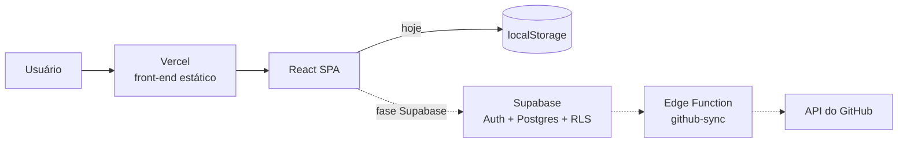

# GovTech MS — Relatório técnico de desenvolvimento (base para o TCC)

> **Para que serve este arquivo:** reunir, em um só lugar, o que foi feito na engenharia do projeto entre **31/10/2026 e 01/11/2026**: o diagnóstico, as decisões e seus motivos, o método de trabalho e os resultados medidos (antes e depois). Ele serve de matéria-prima para os capítulos de **Metodologia**, **Desenvolvimento** e **Resultados** do TCC.
>
> Todos os números vêm de comandos executados no projeto (testes, lint, build e medições no navegador). Nenhum valor foi estimado.
>
> Documentos de apoio: `docs/PLANO_TECNICO.md` (plano completo e registro de execução, §15.9), `docs/TESTES.mmd` (mapa de testes), `DOCUMENTACAO.md` (funcionamento do sistema), `AGENTS.md` (regras do projeto).

---

## Sumário

1. [Contexto e ponto de partida](#1-contexto-e-ponto-de-partida)
2. [Método de trabalho](#2-método-de-trabalho)
3. [Diagnóstico inicial](#3-diagnóstico-inicial)
4. [Decisões de projeto](#4-decisões-de-projeto)
5. [Fases executadas](#5-fases-executadas)
6. [Arquitetura resultante](#6-arquitetura-resultante)
7. [Qualidade de código](#7-qualidade-de-código)
8. [Estratégia e resultados de testes](#8-estratégia-e-resultados-de-testes)
9. [Responsividade](#9-responsividade)
10. [Acessibilidade](#10-acessibilidade)
11. [Defeitos encontrados e corrigidos](#11-defeitos-encontrados-e-corrigidos)
12. [Infraestrutura, deploy e segurança](#12-infraestrutura-deploy-e-segurança)
13. [Indicadores: antes e depois](#13-indicadores-antes-e-depois)
14. [Limitações e trabalhos futuros](#14-limitações-e-trabalhos-futuros)
15. [Lições aprendidas](#15-lições-aprendidas)
16. [Linha do tempo e rastreabilidade](#16-linha-do-tempo-e-rastreabilidade)
17. [Referências técnicas](#17-referências-técnicas)

---

## 1. Contexto e ponto de partida

O **GovTech MS** é uma plataforma web de governança de projetos de TI: acompanhamento de projetos (prazo, responsável, progresso e status), repositórios, pull requests, auditoria e controle de acesso por papéis (RBAC).

**Estado em 31/10/2026:**
- Aplicação **somente front-end**: SPA em React 18 + Vite 6, com React Router 7 e ícones Lucide.
- Dados de exemplo (*mocks*) em código e persistência no `localStorage` do navegador.
- CSS escrito à mão (`tokens.css`, `index.css`, `app.css`) e muito estilo inline (`style={{}}`).
- Sem testes automatizados, sem lint, sem formatação padronizada, sem CI.
- Publicação estática na Vercel.

**Objetivo do trabalho de engenharia:** preparar o projeto para a entrada de um back-end real (**Supabase**: Postgres, autenticação e Row Level Security) com segurança. Ou seja, primeiro organizar, testar e corrigir o front-end, depois conectar o banco.

**Restrições:**

| Restrição | Valor |
|---|---|
| Prazo (defesa) | 18/11/2026 |
| Equipe | 2 desenvolvedores |
| Linguagem | JavaScript (decisão do time: sem TypeScript) |
| Custo | Planos gratuitos (Supabase Free, Vercel Hobby, GitHub) |

---

## 2. Método de trabalho

### 2.1 Ordem das fases
Definida pelo time: **Limpeza → Qualidade → Testes → Nova estrutura → Supabase**.

O raciocínio é de dependência: não se refatora com segurança sem testes, não se escreve teste confiável sobre código com defeitos conhecidos, e não se conecta um banco a um front-end desorganizado.

### 2.2 Ciclo de aprovação
Toda mudança seguiu o ciclo **planejar → aprovar → implementar → verificar → documentar**:
- O plano técnico (`docs/PLANO_TECNICO.md`) foi escrito e aprovado **antes** de qualquer código.
- Nenhuma dependência, ferramenta ou estrutura nova entrou sem aprovação explícita.
- Cada etapa terminou com **evidência**: saída de teste, lint, build e medição no navegador.

### 2.3 Práticas adotadas

| Prática | Como foi aplicada |
|---|---|
| **Git flow simples** | Nunca commitar na `main`; uma branch por assunto (`chore/…`, `test/…`, `refactor/…`, `fix/…`, `docs/…`) e Pull Request para a `main` |
| **Conventional Commits** | Mensagens no formato `tipo(escopo): descrição`, por exemplo `fix(projects): count deadline days from midnight` |
| **Commits atômicos** | Mover arquivo e mudar lógica **nunca** no mesmo commit; cada commit compila e passa nos testes |
| **TDD em correções** | Todo bug corrigido começou por um teste que falhava (seção 11) |
| **Integração contínua** | GitHub Actions roda lint, testes e build em todo PR |
| **Revisão** | Todo PR passa por revisão humana antes do merge (o agente de IA não faz merge) |
| **Medição antes de mexer** | A responsividade foi medida no navegador antes da correção, para atacar a causa e não o sintoma |

### 2.4 Uso de IA no desenvolvimento
O desenvolvimento contou com um assistente de IA (Claude Code) atuando como *tech lead*, sob regras escritas em `AGENTS.md` e `CLAUDE.md`:
- planejar antes de codar e pedir aprovação;
- não instalar nada nem apagar arquivos sem autorização;
- fazer acesso ao banco remoto apenas para leitura;
- documentar cada passo.

Algumas ações sensíveis, como fazer merge de PR e apagar branches remotas, foram bloqueadas pela própria ferramenta e ficaram com o desenvolvedor humano. Isso funcionou como uma camada extra de controle.

---

## 3. Diagnóstico inicial

Antes de qualquer mudança, o código foi lido por inteiro e os problemas foram classificados. Os principais:

| # | Problema | Impacto |
|---|---|---|
| 1 | **Sidebar duplicada** na Visão geral (um layout antigo renderizava uma segunda barra lateral) | Visual quebrado na tela principal |
| 2 | **Projetos salvos na chave `undefined`** do `localStorage` (constante com nome errado) | Dados não persistiam entre sessões de forma confiável |
| 3 | **Status do projeto** inexistente como campo; só havia o cálculo de prazo | Regra de negócio incompleta (o time decidiu: status **manual**) |
| 4 | Código morto: páginas, layouts e componentes sem uso; `console.log` | Confusão e peso desnecessário |
| 5 | Dados de exemplo espalhados dentro dos componentes | Difícil trocar por dados reais |
| 6 | Estilo inline em massa (`style={{}}`) | Impossível aplicar *media queries* (responsividade) |
| 7 | Nenhum teste, lint ou CI | Qualquer mudança poderia quebrar algo sem aviso |
| 8 | Elementos clicáveis sem suporte a teclado; modais sem foco controlado | Barreira de acessibilidade |

---

## 4. Decisões de projeto

### 4.1 Decisões de produto (respondidas pelo time)

| Tema | Decisão |
|---|---|
| Multi-organização | **Sim** |
| Cadastro | **Aberto**. No cadastro a pessoa **cria uma organização** (informando o nome da empresa) e vira admin, ou **entra com o código da organização** e vira `viewer`, para o admin promover depois |
| Status do projeto | **Manual** (Saudável / Atenção / Risco). O semáforo de prazo é uma informação separada e calculada |
| Auditoria | Apenas para revisão; sem cadeia de *hash* |
| Dados pessoais | Nome, e-mail e chave de API do GitHub |
| Chave do GitHub | **Uma por projeto**, cadastrada pelo admin, guardada criptografada (Supabase Vault) |
| Landing page | Mantida, em pasta separada do sistema |
| Mocks | Mantidos até cada funcionalidade ter dado real |
| Linguagem | JavaScript |

### 4.2 Decisões técnicas e seus motivos

| Tema | Escolha | Alternativa descartada | Motivo |
|---|---|---|---|
| Back-end | **Supabase** (Postgres + Auth + RLS) | Back-end próprio (Node/Express) | Banco relacional, autenticação e regras de acesso no próprio banco, sem servidor para manter; cabe no prazo |
| Região do banco | **São Paulo (`sa-east-1`)** | EUA (`us-east-1`) | **LGPD** (dados pessoais no Brasil) e menor latência para usuários brasileiros. A troca foi feita com o banco ainda vazio, quando não custava nada |
| Segurança dos dados | **RLS** em toda tabela, por organização | Filtrar no front-end | O banco nega acesso indevido mesmo se o front-end tiver falha |
| Organização do código | **Por funcionalidade** (`features/projects`, `features/rbac`, …) | Por tipo de arquivo (`pages/`, `components/`) | Tudo de um assunto fica junto; regras de dependência entre pastas são verificáveis |
| Estilo | **CSS Modules** + tokens | Tailwind | Zero dependência nova; reaproveita os tokens existentes; permite *media queries* (o inline não permite) |
| Estado de servidor | **TanStack Query** | `useEffect` + `useState` manual | Cache, carregamento, erro e revalidação prontos; a troca para o Supabase fica restrita a um arquivo |
| Testes | **Vitest + Testing Library** | Jest | Usa a mesma configuração do Vite; testes descrevem o que o usuário vê, não detalhes internos |
| Qualidade | **ESLint 9 + Prettier + Husky** | — | Pré-requisito para refatorar com segurança |
| Integração com GitHub | **Sincronização sob demanda** (botão "Sincronizar" + função no servidor) | Webhooks / GitHub App | Cabe no prazo; a chave nunca chega ao navegador |

---

## 5. Fases executadas

### Fase 1 — Limpeza (31/10)
- Corrigidos a sidebar duplicada e a chave de persistência (`govtech:projects`).
- Criado o campo **status manual** (constante `PROJECT_STATUS`) com seleção no formulário.
- Removidos 10 arquivos mortos (páginas, layouts e componentes sem uso), `console.log` e imports sem uso.
- Dados de exemplo centralizados em um único arquivo de mocks.
- Verificação feita em navegador automatizado: métricas, selos de status, criação de projeto persistindo após recarregar e troca de tema.

### Fase 2 — Qualidade (31/10)
- ESLint 9 (regras de React, Hooks e acessibilidade `jsx-a11y`), Prettier, EditorConfig e fim de linha padronizado (LF).
- **Husky + lint-staged:** lint e formatação rodam automaticamente em todo commit.
- Erros de lint corrigidos e código formatado. Restaram **17 avisos de acessibilidade**, resolvidos na Nova estrutura.
- Atualização de segurança do Vite (6.4.3 → 6.4.5) apontada pelo `npm audit`.

### Fase 3 — Testes (01/11)
- Vitest 5, Testing Library, jsdom e CI no GitHub Actions.
- **32 testes P0** (os mais críticos): regras de projeto, persistência, tela de Projetos e navegação.
- Os testes **encontraram um bug real** no cálculo de prazo (seção 11).

### Fase 4 — Nova estrutura (01/11), em 5 etapas

| Etapa | O que foi feito |
|---|---|
| 1 | App movido para `frontend/`, separado do futuro `backend/`; Husky, CI e Vercel ajustados |
| 2 | `src/` organizado por funcionalidade; alias `@/`; **regras de dependência entre pastas verificadas pelo ESLint** |
| 3 | Rotas aninhadas (`<Outlet>`); Landing carregada sob demanda; avisos (*toasts*) por *Provider*; **busca global consertada** |
| 4 | **Responsividade** (fim da rolagem lateral no celular), **componente `Modal` acessível** e **17 → 0 avisos de acessibilidade** |
| 5 | **Camada de dados:** um único arquivo de acesso a projetos (`projectsApi.js`) + hooks com TanStack Query |

Cada etapa virou um PR, com descrição para o revisor, CI verde e registro no plano (§15.9).

### Fase 5 — Supabase (em andamento)
Projeto criado na região de São Paulo. O modelo de dados, as políticas de RLS e o desenho da integração com o GitHub estão no plano (§4). A primeira *migration* será apresentada como proposta antes de executar.

---

## 6. Arquitetura resultante

### 6.1 Visão geral



### 6.2 Estrutura de pastas

```
govtech/
├── frontend/                 app React + Vite
│   └── src/
│       ├── app/              rotas, layout autenticado, providers
│       ├── landing/          página institucional (carregada sob demanda)
│       ├── features/         uma pasta por área: auth, dashboard, projects,
│       │                     repositories, audit, rbac, settings
│       ├── shared/           ui (Modal, Toast…), layout, hooks, lib, constants
│       ├── mocks/            dados de exemplo
│       ├── styles/           tokens e estilos globais
│       └── test/             configuração dos testes
├── backend/                  (fase Supabase) migrations, seed, testes pgTAP
├── docs/                     plano técnico, mapa de testes, este relatório
└── .github/workflows/        CI
```

### 6.3 Regras de dependência (verificadas automaticamente)
- Uma funcionalidade **não importa** de outra; o que é comum sobe para `shared/`.
- `shared/` não importa de `features/`, `app/` nem `landing/`.
- `landing/` não importa nada do sistema.
- Import relativo para cima (`../`) é proibido; usa-se o alias `@/`.

Essas regras viraram **regra do ESLint** (`no-restricted-imports`). Foram testadas com um arquivo de prova que as violava: 3 erros esperados, 3 erros obtidos.

### 6.4 Camada de dados
```
Tela (ProjectsPage) → hook (useProjects) → TanStack Query (cache ['projects']) → projectsApi.js → localStorage
```
Na fase Supabase, **só o `projectsApi.js` muda**. Telas, hooks e testes de tela continuam iguais, porque os testes trocam a API por uma versão em memória. O arquivo `projectsApi.test.js` define o **contrato** que a versão com Supabase precisa cumprir.

---

## 7. Qualidade de código

| Item | Configuração |
|---|---|
| Lint | ESLint 9 (flat config): React, Hooks, `jsx-a11y`, Prettier; **falha com qualquer aviso** (`--max-warnings 0`) |
| Formatação | Prettier, aplicado automaticamente |
| Pre-commit | Husky + lint-staged (lint e formatação só nos arquivos alterados) |
| CI | GitHub Actions: `npm ci` → lint → testes → build, em todo PR e push na `main` |
| Padronização | EditorConfig, LF, tokens de design (cores, espaçamento e fontes) |
| Dependências | Versões **exatas** nas ferramentas; atualização de segurança via `npm audit` |

---

## 8. Estratégia e resultados de testes

### 8.1 Estratégia
- Modelo **Testing Trophy**: foco em testes de integração de componentes (o que o usuário vê e faz), mais testes unitários das regras de negócio.
- Elementos buscados por **papel e rótulo acessível** (`getByRole`, `getByLabelText`), nunca por classe CSS. Com isso, os testes também validam acessibilidade.
- Datas controladas com relógio falso (`vi.setSystemTime`), para os testes não dependerem do dia em que rodam.
- Mapa completo de casos (P0, P1 e P2) em `docs/TESTES.mmd`.

### 8.2 Evolução

| Momento | Testes |
|---|---|
| 31/10 (início) | 0 |
| Fase Testes (P0) | 32 |
| Nova estrutura, etapa 3 | 37 |
| Etapa 4a | 39 |
| Etapa 4b | 49 |
| Etapa 5 | **55** |

### 8.3 Distribuição atual (55 testes em 9 arquivos)

| Arquivo | Testes | O que cobre |
|---|---|---|
| `shared/lib/projectUtils.test.js` | 17 | Semáforo de prazo, normalização de dados e formatação de data |
| `app/App.test.jsx` | 9 | Sidebar única, navegação, persistência, aviso, landing, busca global, menu da conta, workspace |
| `features/projects/ProjectsPage.test.jsx` | 8 | Listar, criar, editar, excluir, cancelar, teclado, abertura direta, erro de carga |
| `features/projects/storageUtils.test.js` | 7 | Leitura e gravação no `localStorage`, dados corrompidos |
| `features/projects/projectsApi.test.js` | 5 | Contrato da API de dados |
| `shared/ui/Modal.test.jsx` | 5 | Diálogo acessível, foco, `Esc`, botão fechar, Tab preso |
| `features/dashboard/OverviewPage.test.jsx` | 2 | Ordenação por urgência e rótulos de prazo |
| `features/rbac/RbacPage.test.jsx` | 1 | Detalhe de papel em diálogo |
| `shared/layout/ChatbotModal.test.jsx` | 1 | Diálogo, perguntas frequentes e `Esc` |

---

## 9. Responsividade

### 9.1 Método
Antes de corrigir, um script de navegador automatizado mediu a **largura real da página** em 390 px (largura de celular) e listou o elemento mais externo que passava da borda. Assim a correção atacou a **causa**.

### 9.2 Resultado

| Tela | Antes | Depois | Causa encontrada |
|---|---|---|---|
| Login, Projetos, Auditoria, Configurações | 390 px ✅ | 390 px ✅ | — |
| **Visão geral** | **429 px** ❌ | 390 px ✅ | Grid com estilo inline e coluna mínima de 260 px; estilo inline não aceita *media query* |
| **Landing** | **485 px** ❌ | 390 px ✅ | Menu do topo com 3 links e um botão lado a lado |

### 9.3 Solução
- Telas migradas para **CSS Modules**, com abordagem **mobile-first** (1 coluna no celular; colunas extras a partir de 768 e 1024 px).
- Breakpoints únicos do projeto: 640 / 768 / 1024 / 1280 px.
- Escala de espaçamento e de fonte adicionada aos tokens de design.
- Modais viram **folha que sobe da parte de baixo** no celular.
- Conferência visual por capturas de tela em 390 e 1440 px.

---

## 10. Acessibilidade

| Antes | Depois |
|---|---|
| 17 avisos de acessibilidade no lint | **0**, e o lint passou a **bloquear** novos problemas |
| Modais eram caixas posicionadas na tela, sem fundo, sem `Esc` e sem controle de foco | Componente `Modal` com `role="dialog"`, título associado, **foco preso**, `Esc` fecha e o foco **volta** para quem abriu |
| Cartões de projeto clicáveis só com mouse | Abrem com **Enter/Espaço** (o título é um botão que cobre o cartão) |
| Efeitos de *hover* feitos com JavaScript | `:hover` no CSS |
| Botões sem nome (ícone sozinho) | `aria-label` em busca, notificações, avatar e fechar |
| Avisos visuais sem anúncio | Área com `role="status"`: o leitor de tela anuncia a mensagem |
| Busca global sem rótulo | Campo `type="search"` com rótulo acessível; fecha com `Esc` |

A acessibilidade passou a ser **verificada por testes**: buscar elementos por papel e nome só funciona se o elemento for acessível.

---

## 11. Defeitos encontrados e corrigidos

| Defeito | Como foi encontrado | Correção |
|---|---|---|
| Sidebar duplicada | Leitura do código | Remoção do layout antigo |
| Projetos gravados na chave `undefined` | Leitura do código | Constante corrigida + **teste de regressão** |
| **Prazo contado com um dia a mais** (projeto vencido ontem aparecia como "vence hoje") | **Testes automatizados**: 4 casos falharam | O prazo passou a ser comparado à meia-noite, arredondando. Testes escritos **antes** da correção |
| **Busca global nunca abria** | Leitura do código | Teste que falhava primeiro; depois a busca ligada ao botão da barra superior |
| Rolagem lateral no celular | Medição no navegador | CSS Modules mobile-first (seção 9) |
| Nomes gigantes após remover o inline | **Captura de tela** | Estilo global conflitante isolado do componente |
| Favicon inexistente (erro 404 em todo carregamento) | Console do navegador | `favicon.svg` |
| Deploy da Vercel quebrou após mover o app para `frontend/` | Check do PR | Pasta raiz do projeto na Vercel = `frontend` (seção 12) |

**Destaque para o TCC:** o bug de prazo afetava a regra central do produto, o semáforo. Ele estava no código desde o início e só apareceu quando os testes foram escritos. É um exemplo concreto do valor de testar antes de refatorar.

---

## 12. Infraestrutura, deploy e segurança

### 12.1 Ambiente
| Serviço | Uso |
|---|---|
| GitHub | Repositório privado, PRs, revisão e CI (GitHub Actions) |
| Vercel | Deploy do front-end; *preview* automático por PR e produção a cada merge na `main` |
| Supabase | Banco Postgres, autenticação e RLS (projeto em **São Paulo**) |

### 12.2 Incidente de deploy (registrado como estudo de caso)
- **Sintoma:** depois de mover o app para `frontend/`, o deploy de *preview* falhou com `vite: command not found`.
- **Causa:** o projeto da Vercel procurava o `package.json` na raiz do repositório. Sem ele, nenhuma dependência era instalada.
- **Correção:** pasta raiz do projeto na Vercel definida como `frontend`; o mesmo commit foi publicado de novo com sucesso.
- **Lição:** mudanças de estrutura de pastas afetam a configuração de deploy, que fica fora do repositório. Por isso o plano já previa esse passo, e o README documenta a configuração.

### 12.3 Segurança e LGPD
- Banco na região de **São Paulo** (dados pessoais no Brasil).
- **RLS** obrigatória em toda tabela, com teste positivo e negativo de cada regra (pgTAP).
- No front-end, apenas a chave pública (*publishable key*); a chave secreta nunca entra no navegador nem no Git.
- A chave do GitHub fica **criptografada no Vault** do Supabase; o navegador vê só os 4 últimos caracteres.
- Dependências auditadas (`npm audit`); a falha alta do Vite foi corrigida.

---

## 13. Indicadores: antes e depois

| Indicador | 31/10 (início) | 01/11 (após Nova estrutura) |
|---|---|---|
| Testes automatizados | 0 | **55** (9 arquivos) |
| Avisos de acessibilidade (lint) | 17 (após configurar o lint) | **0** |
| Integração contínua | Não havia | Lint + testes + build em todo PR |
| Largura da Visão geral em 390 px | 429 px | **390 px** |
| Largura da Landing em 390 px | 485 px | **390 px** |
| Erros no console do navegador | 404 do favicon | **0** |
| Bugs de regra de negócio conhecidos | 1 oculto (prazo) | 0 conhecidos |
| Arquivos com CSS Module | 0 | 7 |
| Pacote JS inicial (gzip) | 87,60 kB¹ | 98,04 kB² |
| Pacote da Landing | junto com o sistema | separado: 20,80 kB (4,32 kB gzip) |

¹ Medido antes da Nova estrutura.
² Inclui o TanStack Query (camada de dados). Sem ele, a separação da Landing havia reduzido o pacote inicial para 85,11 kB gzip. O aumento é o custo da biblioteca de dados, aceito porque elimina código manual de cache, carregamento e erro na fase Supabase.

---

## 14. Limitações e trabalhos futuros

**Decisões conscientes de escopo (até 18/11):**
- `Button`, `Badge` e `Card` não foram extraídos como componentes: as classes globais já padronizam o visual, e a troca não mudaria a demonstração.
- Ainda usam estilo inline: links da sidebar, menu da conta, Configurações, RBAC, Auditoria, Repositórios e o corpo do chatbot.
- Em Repositórios e RBAC, a tabela rola dentro do próprio quadro no celular (a página não estoura).
- Integração com GitHub por sincronização sob demanda, não por *webhook*.

**Pendências visuais conhecidas:** o selo de status no detalhe do projeto mostra o indicador duas vezes; os cartões de métrica de Projetos ficam com o texto lado a lado no desktop.

**Trabalhos futuros:**
- Back-end Supabase (fase em andamento): autenticação, multi-organização com RLS, auditoria por *trigger* e integração com GitHub.
- Testes de ponta a ponta (Playwright) e de acessibilidade automatizada (axe).
- Chatbot com IA real (decisão em aberto).
- Tempo real (Supabase Realtime) e GitHub App com *webhooks*.

---

## 15. Lições aprendidas

1. **Testes antes de refatorar pagam rápido.** O primeiro teste escrito já achou um bug na regra principal do produto.
2. **Medir antes de corrigir.** A responsividade parecia um problema geral; a medição mostrou que só 2 telas estouravam e apontou a causa exata.
3. **Estilo inline impede responsividade.** Não há *media query* em `style={{}}`; migrar para CSS Modules foi a solução estrutural.
4. **Remover um estilo pode revelar outro.** Ao tirar o inline, uma regra global antiga passou a valer. Só a captura de tela mostrou o problema: os testes de comportamento não pegam defeito visual.
5. **Configuração fora do repositório também é código.** A pasta raiz da Vercel quebrou o deploy; agora está documentada no README e no plano.
6. **Aplicação já carregada não se atualiza sozinha.** Uma aba aberta antes do deploy continuou mostrando a versão antiga até ser recarregada. É o comportamento normal de uma SPA.
7. **Commits pequenos e separados** ("mover" de um lado, "mudar lógica" de outro) tornaram os PRs revisáveis mesmo com dezenas de arquivos movidos.
8. **Regras escritas para a IA** (`AGENTS.md`) mantiveram o assistente dentro do escopo aprovado e geraram documentação consistente.

---

## 16. Linha do tempo e rastreabilidade

| Data | Entrega | Referência |
|---|---|---|
| 31/10 | Diagnóstico, plano técnico, mapa de testes, regras para IA | `docs/PLANO_TECNICO.md`, `docs/TESTES.mmd`, `AGENTS.md` |
| 31/10 | Limpeza | commits `97fb76d`, `33064e6` |
| 31/10 | Qualidade (ESLint, Prettier, Husky) | commits `5476db5`, `bca7ef6`, `ab8ecff` |
| 01/11 | Supabase recriado em São Paulo | projeto `govtech-br` |
| 01/11 | Testes P0 + CI + correção do prazo | PR #1 |
| 01/11 | Nova estrutura, etapas 1 a 3 | PR #2 (inclui #3 e #4) |
| 01/11 | Correção do deploy na Vercel | registrado no plano, §15.9 |
| 01/11 | Responsividade (Visão geral e Landing) | PR #5 |
| 01/11 | Modal acessível e 0 avisos de acessibilidade | PR #6 |
| 01/11 | Camada de dados com TanStack Query | PR #7 |

Repositório: `github.com/oguilhermekenzo/govtech` (privado). Produção: `govtech-three.vercel.app`.

---

## 17. Referências técnicas

Documentação oficial das ferramentas usadas (para citar no TCC):
- React — https://react.dev
- Vite — https://vite.dev
- React Router — https://reactrouter.com
- TanStack Query — https://tanstack.com/query
- Vitest — https://vitest.dev
- Testing Library (princípios de teste) — https://testing-library.com/docs/guiding-principles
- ESLint — https://eslint.org · eslint-plugin-jsx-a11y — https://github.com/jsx-eslint/eslint-plugin-jsx-a11y
- Supabase (Auth, RLS, Vault, Edge Functions) — https://supabase.com/docs
- WAI-ARIA Authoring Practices: padrão de diálogo modal — https://www.w3.org/WAI/ARIA/apg/patterns/dialog-modal/
- WCAG 2.2 — https://www.w3.org/TR/WCAG22/
- Conventional Commits — https://www.conventionalcommits.org
- Lei Geral de Proteção de Dados (Lei nº 13.709/2018) — https://www.planalto.gov.br/ccivil_03/_ato2015-2018/2018/lei/l13709.htm
