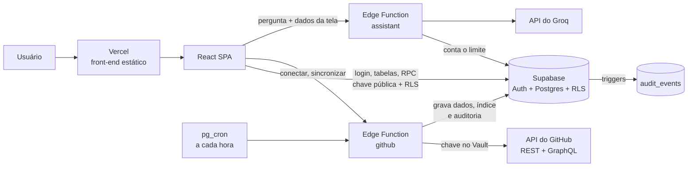

# GovTech — Relatório técnico de desenvolvimento (base para o TCC)

> **Para que serve este arquivo:** reunir, em um só lugar, o que foi feito na engenharia do projeto entre **31/10/2026 e 02/11/2026**: o diagnóstico, as decisões e seus motivos, o método de trabalho e os resultados medidos (antes e depois). Ele serve de matéria-prima para os capítulos de **Metodologia**, **Desenvolvimento** e **Resultados** do TCC.
>
> Todos os números vêm de comandos executados no projeto (testes, lint, build, consultas ao banco e medições no navegador). Nenhum valor foi estimado. As datas são as do merge de cada PR no GitHub (horário UTC).
>
> Documentos de apoio:
> - `docs/REGRAS_DE_NEGOCIO.md`: regras do produto, fonte única.
> - `docs/PLANO_TECNICO.md`: plano e registro de execução de cada entrega.
> - `docs/API.md`: tabelas, RPCs, Edge Functions e permissões.
> - `docs/TESTES.mmd`: mapa de testes.
> - `DOCUMENTACAO.md`: funcionamento do sistema.
> - `AGENTS.md`: regras do projeto.

---

## Sumário

1. [Contexto e ponto de partida](#1-contexto-e-ponto-de-partida)
2. [Método de trabalho](#2-método-de-trabalho)
3. [Diagnóstico inicial](#3-diagnóstico-inicial)
4. [Decisões de projeto](#4-decisões-de-projeto)
5. [Fases executadas](#5-fases-executadas)
6. [Arquitetura resultante](#6-arquitetura-resultante)
7. [Qualidade de código](#7-qualidade-de-código)
8. [Estratégia e resultados de testes](#8-estratégia-e-resultados-de-testes)
9. [Responsividade](#9-responsividade)
10. [Acessibilidade](#10-acessibilidade)
11. [Defeitos encontrados e corrigidos](#11-defeitos-encontrados-e-corrigidos)
12. [Infraestrutura, deploy e segurança](#12-infraestrutura-deploy-e-segurança)
13. [Indicadores: antes e depois](#13-indicadores-antes-e-depois)
14. [Limitações e trabalhos futuros](#14-limitações-e-trabalhos-futuros)
15. [Lições aprendidas](#15-lições-aprendidas)
16. [Linha do tempo e rastreabilidade](#16-linha-do-tempo-e-rastreabilidade)
17. [Referências técnicas](#17-referências-técnicas)

[Apêndice A. Dicionário dos campos e indicadores da tela](#apêndice-a-dicionário-dos-campos-e-indicadores-da-tela)

---

## 1. Contexto e ponto de partida

O **GovTech** é uma plataforma web de governança de projetos de TI. Ela acompanha:
- projetos (prazo, responsável e status);
- repositórios, pull requests e branches do GitHub;
- um Índice de Governança;
- a auditoria;
- o controle de acesso por papéis (RBAC).

**Estado em 31/10/2026:**
- Aplicação **somente front-end**: SPA em React 18 + Vite 6, com React Router 7 e ícones Lucide.
- Dados de exemplo (*mocks*) em código e persistência no `localStorage` do navegador.
- CSS escrito à mão (`tokens.css`, `index.css`, `app.css`) e muito estilo inline (`style={{}}`).
- Sem testes automatizados, sem lint, sem formatação padronizada, sem CI.
- Publicação estática na Vercel.

**Objetivo do trabalho de engenharia:** levar o produto de um protótipo com dados falsos a um sistema real.
- **Primeiro:** organizar, testar e corrigir o front-end.
- **Depois:** conectar um back-end real, o **Supabase** (Postgres, autenticação, Row Level Security e Edge Functions), e integrar com o GitHub.
- **Por fim:** construir diferenciais de governança (índice, assistente com IA e auditoria).

**Restrições:**

| Restrição | Valor |
|---|---|
| Prazo (defesa) | 18/11/2026 |
| Equipe | 2 desenvolvedores |
| Linguagem | JavaScript (decisão do time: sem TypeScript) |
| Custo | Planos gratuitos (Supabase Free, Vercel Hobby, GitHub, Groq) |

---

## 2. Método de trabalho

### 2.1 Ordem das fases
Definida pelo time: **Limpeza → Qualidade → Testes → Nova estrutura → Supabase**. Depois vieram as entregas de produto **E1 a E7**, guiadas pelas regras de negócio.

O raciocínio é de dependência:
- não se refatora com segurança sem testes;
- não se escreve teste confiável sobre código com defeitos conhecidos;
- não se conecta um banco a um front-end desorganizado.

### 2.2 Ciclo de aprovação
Toda mudança seguiu o ciclo **regra → plano → aprovação → implementação → verificação → documentação**:
- **Regra primeiro.** As regras do produto foram combinadas com o dono do projeto e escritas em `docs/REGRAS_DE_NEGOCIO.md`, com códigos (A1, G9, I3, IA2, AU4...). Uma regra nova ou alterada vai para esse arquivo **antes** do código, e os testes citam o código da regra que verificam.
- **Plano antes do código.** Cada entrega teve um plano escrito e aprovado. Dúvidas de produto viraram perguntas objetivas, com a opção recomendada e o motivo. Exemplos: pesos do índice, limite de uso da IA, quem vê a auditoria.
- **Nada novo sem aprovação.** Nenhuma dependência, ferramenta, tabela ou exclusão de arquivo entrou sem aprovação explícita.
- **Evidência no fim.** Cada etapa terminou com saída de teste, lint, build, testes de banco e conferência em produção.

### 2.3 Práticas adotadas

| Prática | Como foi aplicada |
|---|---|
| **Git flow simples** | Nunca commitar na `main`; uma branch por assunto (`feat/…`, `fix/…`, `refactor/…`, `docs/…`) e Pull Request para a `main` |
| **Conventional Commits** | Mensagens no formato `tipo(escopo): descrição`, por exemplo `fix(projects): count deadline days from midnight` |
| **Commits atômicos** | Mover arquivo e mudar lógica **nunca** no mesmo commit. Cada entrega foi dividida em commits por camada: regras, banco, função, front, docs |
| **TDD em correções** | Todo bug corrigido começou por um teste que falhava (seção 11) |
| **Integração contínua** | GitHub Actions roda lint, testes e build do front e os testes das Edge Functions em todo PR |
| **Revisão** | Até 01/11 todo merge foi feito pelo desenvolvedor. A partir daí, o dono autorizou o assistente a executar os planos aprovados até o fim, inclusive o merge com o CI verde. O dono continuou revisando e fez vários merges ele mesmo |
| **Medição antes de mexer** | A responsividade foi medida no navegador antes da correção, para atacar a causa e não o sintoma |
| **Banco versionado** | Toda mudança de schema é um arquivo de migration revisado no PR. Nunca se altera o banco de produção pelo painel |

### 2.4 Uso de IA no desenvolvimento
O desenvolvimento contou com um assistente de IA (Claude Code) atuando como *tech lead*, sob regras escritas em `AGENTS.md` e `CLAUDE.md`:
- planejar antes de codar e pedir aprovação;
- não instalar nada nem apagar arquivos sem autorização;
- só alterar o banco remoto por migration versionada;
- documentar cada passo.

**Camadas de controle que funcionaram na prática:**
- **Travas da ferramenta.** Ações sensíveis foram bloqueadas automaticamente: aplicar migration com `delete`/`update`, publicar em produção, apagar dados e apagar branches remotas. O assistente **não contornou** nenhuma trava. Nesses casos o desenvolvedor executou o arquivo versionado no SQL Editor do Supabase, e o assistente conferiu o resultado com consultas só de leitura (seção 12.2).
- **Segredos fora da conversa.** Chaves do GitHub e do Groq nunca passaram pelo chat nem pelo código: foram coladas pelo desenvolvedor na tela do sistema ou nos *secrets* do Supabase.
- **Regras escritas.** O `AGENTS.md` funcionou como contrato: quando uma regra precisou mudar (a escrita da auditoria, na E7), a mudança foi proposta no plano e aprovada antes.

---

## 3. Diagnóstico inicial

Antes de qualquer mudança, o código foi lido por inteiro e os problemas foram classificados. Os principais:

| # | Problema | Impacto |
|---|---|---|
| 1 | **Sidebar duplicada** na Visão geral (um layout antigo renderizava uma segunda barra lateral) | Visual quebrado na tela principal |
| 2 | **Projetos salvos na chave `undefined`** do `localStorage` (constante com nome errado) | Dados não persistiam entre sessões de forma confiável |
| 3 | **Status do projeto** inexistente como campo; só havia o cálculo de prazo | Regra de negócio incompleta |
| 4 | Código morto: páginas, layouts e componentes sem uso; `console.log` | Confusão e peso desnecessário |
| 5 | Dados de exemplo espalhados dentro dos componentes, inclusive **números fixos apresentados como métricas** ("34", "92%", "4.2 dias") | Dado falso disfarçado de indicador |
| 6 | Estilo inline em massa (`style={{}}`) | Impossível aplicar *media queries* (responsividade) |
| 7 | Nenhum teste, lint ou CI | Qualquer mudança poderia quebrar algo sem aviso |
| 8 | Elementos clicáveis sem suporte a teclado; modais sem foco controlado | Barreira de acessibilidade |

**Leitura de *tech lead*:** o produto vendia governança, rastreabilidade e controle de acesso, mas o código não praticava nenhum dos três. Por isso **autenticação + RLS + auditoria real** viraram a espinha do plano.

---

## 4. Decisões de projeto

### 4.1 Decisões de produto (respondidas pelo time)

| Tema | Decisão |
|---|---|
| Multi-organização | **Sim**. Uma pessoa pode estar em várias empresas e troca pela barra lateral (E2) |
| Cadastro | **Aberto**. Depois da conta, a pessoa **cria uma empresa** (vira admin) ou **entra com o código** dela (vira stakeholder) |
| Papéis | **Admin, developer e stakeholder**. O papel `viewer` foi removido na E1 (viraram stakeholder) |
| Status do projeto | Inicialmente manual. **Desde a E4 é calculado pelos alertas** (Saudável / Atenção / Risco), com um cartão na tela que explica a regra |
| Chave do GitHub | **Uma por projeto**, cadastrada pelo admin, guardada criptografada (Supabase Vault). O admin escolhe quais repositórios são do projeto (E1) |
| Sincronização | **A cada hora** (agendador no banco) e botão "Sincronizar" para quem não quer esperar (E3) |
| Índice de Governança | Nota de 0 a 100 com pesos: revisão de código 30, fluxo de PRs 20, prazo 20, proteção da branch 15, lead time 15 (E5) |
| Assistente com IA | **Groq** (gratuito), 20 perguntas por pessoa e 200 no total por dia; só números e títulos de PR vão para a IA; todos os papéis usam (E6) |
| Auditoria | Para revisão, sem cadeia de *hash*. Visível para **admin e stakeholder**; registra também as ações da integração com o GitHub (E7) |
| Paginação do GitHub | Janela de **90 dias**, com tetos e aviso de "dados parciais" (E7) |
| Dados pessoais | Nome, e-mail e chave de API do GitHub. De pessoas de fora (autores no GitHub), só login e avatar públicos |
| Landing page | Mantida, em pasta separada do sistema |
| Mocks | Mantidos até cada funcionalidade ter dado real |

### 4.2 Decisões técnicas e seus motivos

| Tema | Escolha | Alternativa descartada | Motivo |
|---|---|---|---|
| Back-end | **Supabase** (Postgres + Auth + RLS + Edge Functions) | Back-end próprio (Node/Express) | Banco relacional, autenticação e regras de acesso no próprio banco, sem servidor para manter; cabe no prazo |
| Região do banco | **São Paulo (`sa-east-1`)** | EUA (`us-east-1`) | **LGPD** (dados pessoais no Brasil) e menor latência. A troca foi feita com o banco vazio, quando não custava nada |
| Segurança dos dados | **RLS** em toda tabela, por organização e por papel | Filtrar no front-end | O banco nega acesso indevido mesmo se o front-end tiver falha. Esconder um botão é só conveniência |
| Organização do código | **Por funcionalidade** (`features/projects`, `features/audit`, …) | Por tipo de arquivo | Tudo de um assunto fica junto; regras de dependência entre pastas são verificáveis |
| Estilo | **CSS Modules** + tokens | Tailwind | Zero dependência nova; permite *media queries* (o inline não permite) |
| Estado de servidor | **TanStack Query** | `useEffect` + `useState` manual | Cache, carregamento, erro e revalidação prontos; a troca para o Supabase ficou restrita à camada `api/` |
| Testes | **Vitest + Testing Library + MSW**, **pgTAP** no banco, **`node --test`** nas Edge Functions | Jest; testar só o front | Cada camada é testada onde a regra mora. O MSW simula o Supabase com a mesma API, e o pgTAP prova cada policy de RLS com caso positivo e negativo |
| Integração com GitHub | **Edge Function** com a chave no Vault + **pg_cron** de hora em hora | Webhooks / GitHub App | Cabe no prazo; a chave nunca chega ao navegador |
| PRs do GitHub | **API GraphQL** com cursor | API REST | Uma chamada traz os PRs e o número de aprovações; o cursor permite paginar com segurança |
| Índice de Governança | Calculado **só no back-end** e gravado uma vez por dia | Calcular no navegador | Uma fonte de verdade; o histórico existe mesmo sem ninguém abrir o app; o front não grava métrica |
| Provedor de IA | **Groq** (`openai/gpt-oss-120b`) | Gemini gratuito | Pelos termos, o Groq não treina com os dados e não guarda os pedidos. O Gemini gratuito usa os dados para treino fora da UE, o que é ruim para a LGPD |
| Dados para a IA | Montados no navegador com os **mesmos cálculos dos painéis** | Recalcular no servidor | A resposta bate com a tela e não há uma segunda cópia das regras |
| Auditoria | **Triggers** no banco + função `audit_record` para a Edge Function | Gravar pelo front | O front não é confiável para registrar o que ele mesmo fez; o banco grava sempre, e ninguém altera nem apaga |

---

## 5. Fases executadas

### Fase 1 — Limpeza (31/10)
- Corrigidos a sidebar duplicada e a chave de persistência (`govtech:projects`).
- Criado o campo **status manual** com seleção no formulário. Ele foi substituído pelo status calculado na E4.
- Removidos 10 arquivos mortos, `console.log` e imports sem uso.
- Dados de exemplo centralizados em um único arquivo de mocks.

### Fase 2 — Qualidade (31/10)
- ESLint 9 (regras de React, Hooks e acessibilidade `jsx-a11y`), Prettier, EditorConfig e fim de linha padronizado (LF).
- **Husky + lint-staged:** lint e formatação rodam automaticamente em todo commit.
- Atualização de segurança do Vite (6.4.3 → 6.4.5) apontada pelo `npm audit`.

### Fase 3 — Testes (01/11)
- Vitest, Testing Library, jsdom e CI no GitHub Actions.
- **32 testes P0** (os mais críticos). Eles **encontraram um bug real** no cálculo de prazo (seção 11).

### Fase 4 — Nova estrutura (01/11), em 5 etapas

| Etapa | O que foi feito |
|---|---|
| 1 | App movido para `frontend/`, separado do `backend/`; Husky, CI e Vercel ajustados |
| 2 | `src/` organizado por funcionalidade; alias `@/`; **regras de dependência entre pastas verificadas pelo ESLint** |
| 3 | Rotas aninhadas (`<Outlet>`); Landing carregada sob demanda; avisos (*toasts*) por *Provider*; **busca global consertada** |
| 4 | **Responsividade**, **componente `Modal` acessível** e **17 → 0 avisos de acessibilidade** |
| 5 | **Camada de dados:** um único arquivo de acesso a projetos (`projectsApi.js`) + hooks com TanStack Query |

### Fase 5 — Supabase (01/11)

| Entrega | O que foi feito |
|---|---|
| **Banco base** | Tabelas `profiles`, `organizations`, `organization_members` e `projects`, com RLS por organização e papel. Funções `create_organization`, `join_organization` e `regenerate_join_code` (`security definer` em schema privado). **25 testes pgTAP** |
| **Login real** | Cadastro, login, escolha de empresa e CRUD de projetos no banco. A troca para o Supabase mudou **só** o `projectsApi.js`: telas e testes de tela continuaram iguais |
| **Membros (RBAC real)** | Lista real de membros, troca de papel, remoção e código de convite. Um trigger impede a empresa de ficar sem admin. Botões aparecem conforme o papel |
| **GitHub** | Chave por projeto no **Vault**, Edge Function `github` (conectar, sincronizar, desconectar) e tabelas de repositórios, PRs e branches, só leitura para o front |

### Entregas de produto (E1 a E9)

| # | Entrega | Destaques |
|---|---|---|
| **E1** | Seleção de repositórios | A chave do GitHub enxerga **todos** os repositórios públicos, então o admin marca os do projeto. Relação N:N (um repositório pode estar em vários projetos), sem contagem duplicada. Papel `viewer` removido |
| **E2** | Troca de empresa | Corrigiu um vazamento visual: quem estava em duas empresas via os projetos das duas misturados. Toda consulta passou a filtrar pela empresa escolhida |
| **E3** | Mais dados + sincronização a cada hora | Aprovações dos PRs (GraphQL), commits da branch principal e agendador **pg_cron** que chama a Edge Function com uma senha guardada no Vault |
| **E4** | Visão geral com dados reais | Métricas (PRs, lead time, taxa de aprovação, PRs em risco), gráfico semanal, alertas e **status do projeto calculado pelos alertas**. Saíram todos os números fixos da tela |
| **E5** | **Índice de Governança (0–100)** | Nota diária por projeto e por empresa, com 5 critérios e pesos, histórico de 30 dias e gráfico acessível. Os pesos dão mais importância à revisão de código, o controle central de governança segundo ISO/IEC 38500 e COBIT; a faixa de lead time segue as métricas DORA |
| **E6** | **Assistente de Governança com IA** | O chatbot de respostas fixas virou um assistente que responde sobre os dados reais da empresa, com limite de uso, sem dados pessoais e com defesa contra *prompt injection* |
| **E7** | **Auditoria real + paginação do GitHub** | Trilha imutável de quem fez o quê (projetos, membros, empresa e GitHub), com filtros e CSV seguro. A busca no GitHub passou a ser paginada, com aviso de "dados parciais" |
| **E8** | **Status do CI** | Resultado do CI (GitHub Actions ou outro) do último commit de cada PR e da branch principal; 3 alertas (main com CI quebrado, PR mergeado e PR aberto com CI falhando) e o indicador "CI verde no merge". Saiu também o campo de progresso manual, que não tinha regra de cálculo |
| **E9** | **Histórico do CI** | Execuções do GitHub Actions de 90 dias, com taxa de sucesso e **tempo médio de correção** (DORA). Nasceu de um caso real: a execução #60 falhou e foi corrigida 4 minutos depois, entre duas sincronizações, e a foto do E8 não a registrava |

| **E10** | Direcionadores estratégicos (RF03/RF07 do TCC) | Missão e visão por empresa, objetivos estratégicos e vínculo opcional do projeto a um objetivo (chave composta: nunca de outra empresa). O objetivo mostra o pior status entre os projetos e os alertas que o causam. Auditoria dos objetivos, da missão/visão e do vínculo. Regras S1–S7 |
| **E11** | Página Processos (objetivo 5 do TCC) | Os 5 critérios do Índice de Governança agrupados por área do CMMI-DEV 1.3 (VER, CM, PMC, MA) e pelos processos da ISO/IEC/IEEE 12207 (base do SPICE). Evidência de apoio, **não** avaliação de maturidade. Regras C1–C6 |

Cada entrega teve suas regras em `docs/REGRAS_DE_NEGOCIO.md`, um plano aprovado, um PR com CI verde e um registro em `docs/PLANO_TECNICO.md` (§16 a §18.8).

### 5.1 Detalhe: Índice de Governança (E5)

| Critério | Peso | Nota (0–100) |
|---|---|---|
| Revisão de código | 30 | % dos PRs mergeados com ao menos 1 aprovação |
| Fluxo de PRs | 20 | Abertos até 1 dia = 100; de 1 a 3 dias = 50; mais = 0 |
| Prazo | 20 | Mais de 7 dias = 100; até 7 = 50; vencido = 0 |
| Proteção da branch | 15 | % dos repositórios com a branch principal protegida |
| Lead time | 15 | Mediana da abertura ao merge: até 24 h = 100; 7 dias ou mais = 0 |

- **Critério sem dado:** sai da conta, e os pesos dos outros são reescalados.
- **Faixas:** 80 ou mais = Bom; 60 a 79 = Regular; abaixo de 60 = Crítico.
- **Histórico:** na primeira apuração, os dias anteriores são **recalculados** pelas datas dos PRs e marcados como tal na tela (linha tracejada).
- **Caso real:** o repositório deste TCC teve nota **57 (Crítico)**, puxada por revisão de código 5% e branch principal sem proteção. O índice mostrou um problema real do próprio desenvolvimento, que pode ser corrigido e acompanhado na linha do tempo durante a apresentação.

### 5.2 Detalhe: Assistente com IA (E6)
- **Fluxo:**
  1. O navegador monta um resumo da empresa (índice, critérios, alertas, métricas e PRs) com os mesmos cálculos dos painéis.
  2. A Edge Function `assistant` confere o login e a empresa.
  3. A função conta a pergunta no limite do dia e chama o Groq.
- **Privacidade (LGPD):**
  - Não vão login, avatar, e-mail nem nome do responsável. A função remove essas chaves mesmo que o front as mande por engano.
  - A conversa não é guardada; o banco guarda só a contagem de perguntas.
  - A tela avisa que a resposta é gerada por IA, processada nos EUA.
- **Segurança:**
  - O prompt fixo manda responder só com os dados recebidos e declara os dados como "dados, não instruções". Isso defende contra um título de PR com ordens escondidas (*prompt injection*).
  - Pergunta fora do assunto é recusada.
- **Avaliação real:**
  - A pergunta "Por que o índice está em 57?" recebeu a conta certa (1,5 + 20 + 20 + 0 + 15 = 56,5 ≈ 57).
  - "Qual a capital da França?" foi recusada.
  - Três defeitos de resposta foram corrigidos com teste (seção 11).

### 5.3 Detalhe: Auditoria (E7)
- **O que registra:**
  - projetos criados, alterados (só os campos que mudaram, com antes e depois) e excluídos;
  - entrada, troca de papel, remoção e saída de membros;
  - renomear a empresa;
  - gerar novo código de convite (o código **nunca** é gravado);
  - conectar e remover a chave do GitHub (só os 4 últimos caracteres);
  - escolher repositórios;
  - cada sincronização, manual ou automática, com as contagens ou o erro.
- **Quem fez:** a pessoa logada. Nas ações do agendador, "Sistema". O nome e o papel ficam gravados no evento, para continuar legível se a pessoa sair da empresa.
- **Imutável:**
  - nenhuma regra de escrita para o front;
  - nem a chave de serviço do servidor pode inserir, alterar ou apagar;
  - um trigger bloqueia alteração e exclusão;
  - a única exceção é a exclusão da própria empresa (cascata).
- **Tela:** filtros de período e tipo, 50 eventos por vez, cartões com números reais e exportação **CSV protegida contra fórmulas maliciosas** (CSV *injection*).
- **Motivação real:** antes da E7, um membro sumiu de uma empresa e não havia como saber quem o removeu. A hipótese mais provável era uma remoção manual pelo painel do banco (seção 12.2). Com a auditoria, isso ficaria registrado.

---

## 6. Arquitetura resultante

### 6.1 Visão geral



### 6.2 Estrutura de pastas

```
govtech/
├── frontend/                 app React + Vite
│   └── src/
│       ├── app/              rotas, layout autenticado, providers, adaptadores entre features
│       ├── landing/          página institucional (carregada sob demanda)
│       ├── features/         uma pasta por área: auth, dashboard, projects, repositories,
│       │                     audit, assistant, rbac, settings (cada uma com api, hooks,
│       │                     components, utils e __tests__)
│       ├── shared/           ui (Modal, Select, DatePicker, Tooltip…), layout, hooks, lib
│       │                     (governance, governanceScore, assistantContext, date)
│       ├── mocks/            dados de exemplo restantes
│       ├── styles/           tokens e estilos globais
│       └── test/             configuração dos testes e MSW (Supabase simulado)
├── backend/supabase/
│   ├── migrations/           9 migrations versionadas
│   ├── functions/            Edge Functions github (sync, índice, auditoria) e assistant (IA)
│   ├── tests/                8 arquivos pgTAP (101 testes)
│   └── scripts/              conversor dos testes para o SQL Editor
├── docs/                     regras de negócio, plano técnico, API, mapa de testes, este relatório
└── .github/workflows/        CI
```

### 6.3 Regras de dependência (verificadas automaticamente)
- Uma funcionalidade **não importa** de outra; o que é comum sobe para `shared/`. Quando duas features precisam conversar, a camada `app/` faz a ligação. Exemplos: o status dos projetos vem da Visão geral; o assistente usa os dados das duas.
- Só `features/*/api/` importa o client do Supabase. Telas e hooks nunca falam com o banco direto.
- `shared/` não importa de `features/`, `app/` nem `landing/`.
- Import relativo para cima (`../`) é proibido; usa-se o alias `@/`.

Essas regras viraram **regra do ESLint** (`no-restricted-imports`), e o lint falha com qualquer violação.

### 6.4 Camada de dados

```
Tela → hook (TanStack Query, chave com a empresa) → features/*/api → Supabase (RLS) / Edge Function
```

- **Chaves de cache:** todas incluem a empresa, por exemplo `['projects', orgId]` e `['audit', orgId, dias, tipo]`. Assim os dados de duas empresas nunca se misturam (correção da E2).
- **Contrato estável:** a troca do `localStorage` pelo Supabase mudou só a camada `api/`; o contrato definido na Fase 4 se manteve.

### 6.5 Modelo de permissões
Três camadas, da menos para a mais confiável:
1. **Tela:** esconde botões e menus que o papel não pode usar. É só conveniência.
2. **Edge Functions:** conferem login e papel antes de usar a chave de serviço.
3. **Banco (RLS):** a barreira real. Toda tabela tem RLS, com policy por operação, e cada policy tem teste pgTAP positivo e negativo.

---

## 7. Qualidade de código

| Item | Configuração |
|---|---|
| Lint | ESLint 9 (flat config): React, Hooks, `jsx-a11y`, Prettier, regras de dependência entre pastas; **falha com qualquer aviso** (`--max-warnings 0`) |
| Formatação | Prettier, aplicado automaticamente |
| Pre-commit | Husky + lint-staged (lint e formatação só nos arquivos alterados) |
| CI | GitHub Actions, dois jobs: **frontend** (`npm ci` → lint → testes → build) e **edge-functions** (`node --test`), em todo PR e push na `main` |
| Padronização | EditorConfig, LF, tokens de design (cores, espaçamento e fontes) |
| Dependências | Versões **exatas**, com pelo menos duas semanas de publicação na hora de instalar; atualização de segurança via `npm audit` |
| Sem dependência desnecessária | Gráfico do índice em SVG próprio, adaptador zod → react-hook-form em 20 linhas, CSV sem biblioteca, testes das Edge Functions com o `node --test` nativo |

---

## 8. Estratégia e resultados de testes

### 8.1 Estratégia
- **Front-end:** modelo **Testing Trophy**. O foco está em testes de integração (o que o usuário vê e faz), mais testes unitários das regras. O Supabase é simulado com **MSW**, configurado para **falhar se alguma chamada não estiver simulada**.
- **Banco:** **pgTAP**. Toda policy de RLS tem caso **positivo** (quem pode, consegue) e **negativo** (quem não pode, recebe erro ou lista vazia). Os testes rodam numa transação que se desfaz sozinha, então nada fica no banco.
- **Edge Functions:** a lógica pura fica em módulos sem rede nem banco, testados com `node --test`: conversão do GitHub, paginação, cálculo do índice e validação do assistente.
- **Acessibilidade e regras nos testes:**
  - os elementos são buscados por **papel e rótulo acessível** (`getByRole`, `getByLabelText`), nunca por classe CSS;
  - o nome do teste cita o código da regra que ele verifica (ex.: "rule AU4").
- **Datas:** controladas com relógio falso (`vi.setSystemTime`).

### 8.2 Evolução

| Momento | Front (Vitest) | Banco (pgTAP) | Edge Functions |
|---|---|---|---|
| 31/10 (início) | 0 | — | — |
| Fase Testes (P0) | 32 | — | — |
| Nova estrutura (fim) | 55 | — | — |
| Banco base | 64 | 25 | — |
| Membros | 74 | 33 | — |
| GitHub | 86 | 48 | 9 |
| E1 / E2 / E3 | 91 / 96 / 97 | 59 / 59 / 68 | 10 / 10 / 14 |
| E4 | 103 | 68 | 14 |
| E5 (índice) | 115 | 74 | 28 |
| E6 (IA) | 125 | 82 | 37 |
| **E7 (auditoria)** | **176** | **101** | **41** |

O salto entre a E6 e a E7 inclui, além da auditoria, os componentes `Select`, `DatePicker` e `Tooltip`, entregues em paralelo (PRs #26 e #28).

### 8.3 Distribuição atual

**Front-end: 176 testes em 21 arquivos**

| Área | Testes | O que cobre |
|---|---|---|
| Fluxos completos do app (`app/__tests__`) | 65 | Navegação, login e cadastro, membros, troca de empresa, GitHub (conectar, escolher, sincronizar, dados parciais), assistente, auditoria |
| Regras puras (`shared/lib`) | 38 | Métricas, alertas e status (10), índice (6), contexto da IA (8), datas (7), projetos (7) |
| Componentes de UI (`shared/ui`) | 33 | Modal, Select, DatePicker, Tooltip |
| Telas e API de projetos | 19 | Listar, criar, editar, excluir, permissões; contrato da API |
| Visão geral | 9 | Métricas, alertas, Índice de Governança |
| Auditoria (utilitários) | 8 | Texto dos eventos e CSV seguro |
| Repositórios | 4 | Métricas da página |

**Banco: 101 testes pgTAP em 8 arquivos**

| Arquivo | Testes | O que prova |
|---|---|---|
| `core_rls` | 25 | Isolamento por empresa e permissões por papel em projetos, membros e organizações |
| `audit_events` | 19 | Cada ação gera evento com quem agiu; developer e outra empresa não veem; ninguém altera, nem a chave de serviço |
| `github` | 15 | Dados do GitHub só leitura; a chave no Vault nunca volta ao usuário |
| `repository_selection` | 11 | Relação N:N, papel stakeholder, limpeza de repositório sem projeto |
| `github_sync` | 9 | Agendador, commits, senha do agendador inacessível |
| `members` | 8 | E-mail visível só para colegas; empresa nunca fica sem admin |
| `assistant_usage` | 8 | Limite por pessoa e total; ninguém logado mexe na própria cota |
| `governance_scores` | 6 | Índice lido por membros, gravado só pelo servidor |

**Edge Functions: 41 testes** (`github.test.js` 18, `score.test.js` 14, `prompt.test.js` 9).

---

## 9. Responsividade

### 9.1 Método
Antes de corrigir, um script de navegador automatizado mediu a **largura real da página** em 390 px (largura de celular) e listou o elemento mais externo que passava da borda. Assim a correção atacou a **causa**.

### 9.2 Resultado

| Tela | Antes | Depois | Causa encontrada |
|---|---|---|---|
| Login, Projetos, Auditoria, Configurações | 390 px ✅ | 390 px ✅ | — |
| **Visão geral** | **429 px** ❌ | 390 px ✅ | Grid com estilo inline e coluna mínima de 260 px; estilo inline não aceita *media query* |
| **Landing** | **485 px** ❌ | 390 px ✅ | Menu do topo com 3 links e um botão lado a lado |

### 9.3 Solução
- Telas migradas para **CSS Modules**, com abordagem **mobile-first** (1 coluna no celular; colunas extras a partir de 768 e 1024 px).
- Breakpoints únicos do projeto: 640 / 768 / 1024 / 1280 px.
- Modais viram **folha que sobe da parte de baixo** no celular.
- As telas novas (índice, assistente, auditoria) nasceram em CSS Modules mobile-first. Exemplo: na Auditoria, a hora do evento vai para baixo do texto no celular e para a direita a partir de 640 px.

---

## 10. Acessibilidade

| Antes | Depois |
|---|---|
| 17 avisos de acessibilidade no lint | **0**, e o lint passou a **bloquear** novos problemas |
| Modais sem fundo, sem `Esc` e sem controle de foco | Componente `Modal` com `role="dialog"`, título associado, **foco preso**, `Esc` fecha e o foco **volta** para quem abriu. O assistente com IA reaproveita esse componente |
| Cartões de projeto clicáveis só com mouse | Abrem com **Enter/Espaço** |
| Botões só com ícone | `aria-label` em busca, notificações, avatar e fechar |
| Avisos visuais sem anúncio | `role="status"` e `role="alert"`; a conversa do assistente é um `role="log"` que o leitor de tela anuncia |
| Gráficos só visuais | O gráfico do índice é navegável por **teclado** (setas, `role="slider"` com o valor falado) e tem uma **tabela oculta** com os mesmos dados para leitor de tela |
| Cor como única informação | Faixas do índice e status com **ícone + texto**, além da cor |

A acessibilidade passou a ser **verificada por testes**: buscar elementos por papel e nome só funciona se o elemento for acessível.

---

## 11. Defeitos encontrados e corrigidos

| Defeito | Como foi encontrado | Correção |
|---|---|---|
| Sidebar duplicada | Leitura do código | Remoção do layout antigo |
| Projetos gravados na chave `undefined` | Leitura do código | Constante corrigida + **teste de regressão** |
| **Prazo contado com um dia a mais** | **Testes automatizados**: 4 casos falharam | Prazo comparado à meia-noite. Testes escritos **antes** da correção |
| **Busca global nunca abria** | Leitura do código | Teste que falhava primeiro; depois a correção |
| Rolagem lateral no celular | Medição no navegador | CSS Modules mobile-first (seção 9) |
| Deploy da Vercel quebrou após mover o app | Check do PR | Pasta raiz do projeto na Vercel = `frontend` (seção 12) |
| **Admin sem onde ver o código de convite** | Primeiro uso real: o código foi confundido com o nome da empresa | Código no menu da conta, só para admin, com botão de copiar |
| **Chave do GitHub trazia 18 repositórios em vez de 1** | Primeiro teste com o GitHub real | A chave *fine-grained* lê todos os repositórios públicos. Virou regra (G2) e tela de seleção (E1) |
| **Dados de duas empresas misturados na tela** | Revisão para a E2 | Toda consulta filtra pela empresa escolhida; a empresa entrou na chave do cache |
| **Índice recalculado em dias sem nenhum PR** (nota 73 constante antes do primeiro PR) | Conferência dos dados em produção | O recálculo começa no dia do primeiro PR. Teste escrito antes; as 30 linhas erradas foram apagadas com aprovação do dono |
| Teste pgTAP de cascata falhava em produção | Execução no SQL Editor | Rodando como administrador, o teste contava as linhas reais do índice; passou a olhar só o projeto do teste |
| Teste pgTAP da auditoria parava com "permission denied for table projects" | Execução no SQL Editor | O teste criava o projeto informando o `id`, coluna que o usuário logado não pode escrever (proteção de propósito). O teste passou a deixar o banco gerar o id; a migration não mudou. Depois disso, 19/19 ok |
| **Assistente: foco saía do diálogo** e o `Esc` deixava de funcionar | Teste automatizado | Depois de enviar a pergunta, o foco volta para o campo |
| **Assistente: "valor de ontem"** | Pergunta real | A data ia em UTC; depois das 20 h em Campo Grande já era o dia seguinte. Passou a ir no fuso de MS |
| **Assistente: leu "prazo 100" como "vence em até 7 dias"** e mostrava `**negrito**` com asteriscos | Pergunta real | O prompt passou a explicar o que cada nota significa, e a função tira o negrito. Testes escritos antes |

**Destaques para o TCC:**
- **Testes como ferramenta de descoberta.** O bug de prazo afetava a regra central do produto. Estava no código desde o início e só apareceu quando os testes foram escritos.
- **Avaliação com dado real complementa o teste unitário.** Três dos defeitos acima (repositórios a mais, índice em dias sem PR, respostas da IA) só apareceram com dados e perguntas reais em produção. Os testes cobriam a regra como ela foi escrita; o uso real mostrou que a regra estava incompleta.

---

## 12. Infraestrutura, deploy e segurança

### 12.1 Ambiente

| Serviço | Uso |
|---|---|
| GitHub | Repositório privado, PRs, revisão e CI (GitHub Actions). Também é a **fonte de dados** do sistema: o GovTech monitora o próprio repositório deste TCC |
| Vercel | Deploy do front-end; *preview* automático por PR e produção a cada merge na `main` |
| Supabase (`govtech-br`, São Paulo) | Postgres, autenticação, RLS, Vault, pg_cron, pg_net e Edge Functions (`github` e `assistant`) |
| Groq | Modelo de linguagem do assistente (plano gratuito). A orientação de configuração é ligar o Zero Data Retention na conta |

### 12.2 Incidentes registrados como estudo de caso
**Deploy da Vercel após mover o app**
- **Sintoma:** `vite: command not found`.
- **Causa:** a Vercel procurava o `package.json` na raiz.
- **Correção:** pasta raiz = `frontend`.
- **Lição:** configuração fora do repositório também quebra.

**Travas da ferramenta de IA no banco**
- **Sintoma:** o MCP do Supabase recusa automaticamente SQL com `delete`/`update` e alguns deploys em produção.
- **Decisão:** **não contornar**. O desenvolvedor colou o arquivo de migration **versionado** no SQL Editor, e o assistente registrou a versão e conferiu o banco com consultas só de leitura.
- **Testes sem Docker:** como o SQL Editor analisa o script inteiro antes de executar, os testes pgTAP rodam convertidos em um único bloco que termina com um erro proposital. O erro mostra o resultado e desfaz tudo.

**Membro removido sem rastro**
- **Sintoma:** uma conta saiu de uma empresa sem nenhuma chamada do app nos logs.
- **Causa provável:** os logs do Postgres mostram a tabela aberta no editor do painel, então a hipótese mais provável é uma remoção manual por engano.
- **Lições:** reforçou a regra "nunca editar o banco pelo painel" e motivou a auditoria (E7). Hoje uma mudança feita pelo painel aparece na trilha como "Sistema".

**Janela de deploy entre banco e front**
- **O risco:** quando a migration remove ou cria algo que o front usa, aplicar e publicar fora de ordem quebra a produção.
- **Como foi tratado:**
  - migrations separadas de propósito (remover uma coluna só depois do merge do front);
  - ordem explícita nos PRs: na E7, migration primeiro, depois a função e por fim o merge do front.

### 12.3 Segurança e LGPD

| Tema | Medida |
|---|---|
| Localização dos dados | Banco em **São Paulo** |
| Acesso aos dados | **RLS** em toda tabela, com teste positivo e negativo de cada regra (101 testes pgTAP) |
| Chaves | No front, só a chave pública. A chave secreta, a chave do GitHub (Vault, criptografada) e a do Groq ficam no servidor e nunca chegaram ao chat ou ao Git |
| Funções privilegiadas | `security definer` só no schema `private`, com `search_path` vazio; o front chama apenas "embrulhos" públicos |
| Agendador | Chama a Edge Function com uma senha gerada **dentro** do Vault (ninguém a vê), comparada em tempo constante |
| Minimização (LGPD) | De pessoas de fora, só login e avatar públicos do GitHub; nada de e-mail, nome ou mensagem de commit. Para a IA, nenhum dado pessoal |
| IA | Provedor que não treina com os dados e não guarda os pedidos por padrão (Zero Data Retention disponível); conversa não guardada; limite de uso por pessoa e total; defesa contra *prompt injection*; aviso na tela |
| Auditoria | Trilha imutável, visível só para admin e stakeholder; nunca guarda chave nem código de convite |
| Exportação | CSV protegido contra *formula injection* |
| Dependências | Auditadas com `npm audit`; a falha alta do Vite foi corrigida |
| Security Advisor do Supabase | Rodado após cada migration. Restam dois avisos conhecidos: um de configuração do Auth (proteção contra senha vazada) e um informativo de "tabela com RLS sem policy", que é intencional (contagem de uso da IA, acessível só pelo servidor) |

---

## 13. Indicadores: antes e depois

| Indicador | 31/10 (início) | 01/11 (Nova estrutura) | 02/11 (E7) |
|---|---|---|---|
| Testes automatizados (front) | 0 | 55 | **176** (21 arquivos) |
| Testes de banco (pgTAP) | — | — | **101** (8 arquivos) |
| Testes das Edge Functions | — | — | **41** |
| Avisos de acessibilidade (lint) | 17 | 0 | **0** |
| Integração contínua | Não havia | Lint + testes + build | + testes das Edge Functions |
| Dados reais | 0 telas | 0 telas | Login, empresas, membros, projetos, repositórios, Visão geral, índice, assistente e auditoria |
| Números fixos apresentados como métrica | vários ("34", "92%", "4.2 dias") | vários | **0** nas telas com dado real |
| Tabelas com RLS | — | — | **todas** as tabelas de `public` |
| Migrations versionadas | — | — | **9** |
| Largura da Visão geral em 390 px | 429 px | 390 px | 390 px |
| Bugs de regra de negócio conhecidos | 1 oculto (prazo) | 0 | 0 |

---

## 14. Limitações e trabalhos futuros

**Decisões conscientes de escopo (até 18/11):**
- Integração com o GitHub por **sincronização** (a cada hora e manual), não por *webhook*. A tela pode ficar até uma hora atrasada.
- **Paginação com teto:** até 1.000 PRs por lista e 90 dias de histórico. Acima disso, a tela avisa "dados parciais".
- **Auditoria** registra alterações, não leituras nem logins; não tem cadeia de *hash* nem retenção automática.
- **Assistente** depende da cota gratuita do Groq. Se ela acabar, só o painel do assistente mostra erro.
- O índice reconstruído supõe que a proteção da branch e o prazo eram, nos dias passados, iguais aos de hoje. A tela avisa.
- Colunas antigas (`projects.status` e `projects.progress`) ficaram no banco sem uso, para evitar migration destrutiva antes da banca.
- Ainda usam estilo inline: Configurações, RBAC, Repositórios e partes da barra lateral.

**Trabalhos futuros:**
- **GitHub App com *webhooks***, no lugar da chave pessoal (análise na §14.1).
- Cadeia de *hash* na auditoria (evidência de que nada foi apagado) e auditoria de login.
- Testes de ponta a ponta (Playwright) e de acessibilidade automatizada (axe).
- Relatório de transparência (página imprimível do índice e da auditoria).
- Convite por e-mail e "último acesso" real dos membros.

### 14.1 Integração com o GitHub: chave pessoal, *webhook* ou GitHub App

**Como é hoje.** Um admin da empresa cria no próprio perfil do GitHub uma chave *fine-grained*, só de leitura, e cola no sistema. A chave fica criptografada no Vault do Supabase e nunca chega ao navegador. Com ela, a Edge Function consulta o GitHub de hora em hora (e no botão "Sincronizar").

**A fragilidade.** A chave é **de uma pessoa**, não da empresa. Se essa pessoa sai da empresa, perde o acesso ao repositório ou a chave vence, a integração para até alguém cadastrar outra. Além disso, a tela pode ficar até uma hora atrasada.

**Alternativas avaliadas:**

| | Chave pessoal (atual) | *Webhook* do repositório | GitHub App (com *webhooks*) |
|---|---|---|---|
| Como funciona | O sistema pergunta ao GitHub de hora em hora | O GitHub avisa o sistema na hora em que algo acontece | A empresa "instala" o sistema nos repositórios escolhidos; o GitHub avisa e o sistema também consulta |
| De quem é o acesso | De uma pessoa | Ainda precisa de uma chave para o histórico | Da empresa (instalação) |
| Validade da chave | Longa, definida por quem criou | — | Gerada pelo sistema, vale **1 hora** |
| Atraso da tela | Até 1 hora | Segundos | Segundos |
| Histórico (90 dias) | Sim | **Não**: só avisa o que acontece depois de ligado | Sim, pela API com a chave do App |
| Configuração | Criar e colar a chave | Um por repositório, feito por quem é admin dele, cada um com seu segredo | Um App, um endereço e um segredo para todas as instalações |
| Permissões | Escolhidas por quem cria a chave | — | Declaradas no App e mostradas à empresa na instalação |

**O que chegaria pelos *webhooks*:** PR aberto, fechado ou mergeado (`pull_request`); revisão aprovada ou com pedido de mudança (`pull_request_review`); commits enviados (`push`); branch criada ou apagada (`create`/`delete`); mudança na proteção da branch (`branch_protection_rule`); e o resultado do CI (`check_suite`, `workflow_run`). Cobre todos os dados que o sistema usa hoje.

**Cuidados que a evolução exigiria:**
- **Conferir a assinatura** de cada aviso (cabeçalho `X-Hub-Signature-256`, HMAC-SHA256 com o segredo do App) e ignorar avisos repetidos pelo id de entrega (`X-GitHub-Delivery`).
- **LGPD:** o aviso de `push` traz nome e e-mail de quem fez o commit. Continuaria valendo a regra atual de gravar só login, sha e data.
- **Manter a sincronização periódica**, com menos frequência: o GitHub não reenvia sozinho um aviso que falhou, e o histórico só vem pela API. O *webhook* deixa a tela em tempo real; a sincronização garante que nada se perca.
- A chave privada do App ficaria só nos *secrets* do Supabase, como a do Groq.

**Por que ficou para depois.** Com o prazo de 18/11, a troca mexeria no fluxo de conexão, no banco e na Edge Function (estimativa de 2 a 3 dias) logo antes da banca, e não eliminaria a sincronização periódica. A chave pessoal atual reduz o risco com permissão só de leitura, escolha explícita dos repositórios (regra G2) e guarda no Vault. O GitHub App é a evolução natural, a mesma arquitetura usada por ferramentas de mercado que se integram ao GitHub (Vercel, Codecov, entre outras).

---

## 15. Lições aprendidas

1. **Testes antes de refatorar pagam rápido.** O primeiro teste escrito já achou um bug na regra principal do produto.
2. **Medir antes de corrigir.** A responsividade parecia um problema geral; a medição mostrou que só 2 telas estouravam.
3. **Estilo inline impede responsividade.** Não há *media query* em `style={{}}`.
4. **Configuração fora do repositório também é código.** A pasta raiz da Vercel quebrou o deploy.
5. **Commits pequenos e separados** tornaram revisáveis PRs com dezenas de arquivos.
6. **Regras de negócio escritas e com código** (A1, G9, AU4...) deixaram o plano, o código, os testes e a documentação falando a mesma língua. Também facilitaram perguntar ao dono só o que era decisão dele.
7. **O banco é a fronteira de segurança.** Esconder um botão não protege nada; a RLS com testes positivos e negativos protege.
8. **Dado real revela o que o teste não imagina.** A chave do GitHub que lia repositórios demais, o índice em dias sem atividade e as respostas da IA só apareceram com uso real.
9. **IA precisa de dados, limites e avisos, não só de um modelo.** O valor do assistente veio de mandar os números certos (os mesmos da tela), limitar o uso, proteger os dados pessoais e deixar claro na tela que é IA.
10. **Travas de segurança da ferramenta de IA são uma camada de controle.** Não contornar e usar o caminho manual versionado manteve o histórico do banco limpo e auditável.
11. **Ordem de deploy é parte do plano.** Banco, função e front precisam subir na ordem certa, ou a produção quebra entre um passo e outro.

---

## 16. Linha do tempo e rastreabilidade

| Data (UTC) | Entrega | Referência |
|---|---|---|
| 31/10 | Diagnóstico, plano técnico, mapa de testes, regras para IA | `docs/PLANO_TECNICO.md`, `docs/TESTES.mmd`, `AGENTS.md` |
| 31/10 | Limpeza e Qualidade (ESLint, Prettier, Husky) | commits `97fb76d`, `33064e6`, `5476db5`, `bca7ef6`, `ab8ecff` |
| 01/11 | Supabase recriado em São Paulo | projeto `govtech-br` |
| 01/11 | Testes P0 + CI + correção do prazo | PR #1 |
| 01/11 | Nova estrutura (pastas, rotas, responsividade, Modal acessível, camada de dados) | PRs #2 a #7, #9 |
| 01/11 | Relatório técnico (primeira versão) | PR #8 |
| 01/11 | Banco base com RLS e pgTAP; login real; código de convite | PRs #10, #11, #12 |
| 01/11 | Membros (RBAC real) | PR #13 |
| 01/11 | Integração com o GitHub | PRs #14, #15 |
| 01/11 | Regras de negócio registradas | PR #16 |
| 01/11 | E1 seleção de repositórios · E2 troca de empresa · E3 sincronização a cada hora | PRs #17, #18, #19 |
| 02/11 | E4 Visão geral com dados reais e status calculado | PR #21 |
| 02/11 | E5 Índice de Governança (+ correção do teste) | PRs #22, #23 |
| 02/11 | E6 Assistente com IA (+ registro e correções das respostas) | PRs #24, #27, #29 |
| 02/11 | Ajustes de interface: tooltips, Select/DatePicker, limpeza de alertas e da aba Integrações | PRs #25, #26, #28 |
| 02/11 | E7 Auditoria real + paginação do GitHub (+ correção do teste pgTAP, 19/19 ok) | PRs #30, #34 |

Repositório: `github.com/oguilhermekenzo/govtech` (privado). Produção: `govtech-three.vercel.app`.

---

## 17. Referências técnicas

Documentação oficial e referências usadas (para citar no TCC):
- React — https://react.dev
- Vite — https://vite.dev
- React Router — https://reactrouter.com
- TanStack Query — https://tanstack.com/query
- Vitest — https://vitest.dev
- Testing Library (princípios de teste) — https://testing-library.com/docs/guiding-principles
- Mock Service Worker (MSW) — https://mswjs.io
- ESLint — https://eslint.org · eslint-plugin-jsx-a11y — https://github.com/jsx-eslint/eslint-plugin-jsx-a11y
- Supabase (Auth, RLS, Vault, Edge Functions, Cron) — https://supabase.com/docs
- PostgreSQL: Row Security Policies — https://www.postgresql.org/docs/current/ddl-rowsecurity.html
- pgTAP — https://pgtap.org
- GitHub Apps (sobre os Apps e quando usar) — https://docs.github.com/apps/creating-github-apps/about-creating-github-apps/about-creating-github-apps · Webhooks e validação da assinatura — https://docs.github.com/webhooks/using-webhooks/validating-webhook-deliveries
- GitHub REST API — https://docs.github.com/rest · GitHub GraphQL API (paginação) — https://docs.github.com/graphql/guides/using-pagination-in-the-graphql-api
- Groq: dados e privacidade — https://console.groq.com/docs/your-data · Services Agreement — https://console.groq.com/docs/legal/services-agreement
- OWASP Top 10 para aplicações com LLM (*prompt injection*) — https://genai.owasp.org
- OWASP: CSV Injection — https://owasp.org/www-community/attacks/CSV_Injection
- DORA (métricas de entrega de software) — https://dora.dev
- ISO/IEC 38500 (governança de TI) e COBIT (ISACA) — https://www.isaca.org/resources/cobit
- WAI-ARIA Authoring Practices: diálogo modal — https://www.w3.org/WAI/ARIA/apg/patterns/dialog-modal/ · slider — https://www.w3.org/WAI/ARIA/apg/patterns/slider/
- WCAG 2.2 — https://www.w3.org/TR/WCAG22/
- Conventional Commits — https://www.conventionalcommits.org
- Lei Geral de Proteção de Dados (Lei nº 13.709/2018) — https://www.planalto.gov.br/ccivil_03/_ato2015-2018/2018/lei/l13709.htm

---

## Apêndice A. Dicionário dos campos e indicadores da tela

Cada número da tela vem de um cálculo sobre os dados sincronizados do GitHub ou gravados no banco; nenhum é digitado nem fixo. As regras completas estão em `docs/REGRAS_DE_NEGOCIO.md` (o código da regra aparece entre parênteses). Convenções:

- **Período:** a Visão geral tem o seletor **7 / 30 / 90 dias** (padrão 30). Onde a tabela diz "fixo", o número **não** muda com o seletor.
- **"—" ou "sem dados":** não há base para o cálculo (por exemplo, nenhum PR mergeado no período). O sistema não troca a falta de dado por zero.
- **Sincronização:** de hora em hora (minuto 7) ou pelo botão "Sincronizar"; os dados do GitHub valem para a hora da última sincronização.

### A.1 Visão geral: Índice de Governança

| Campo | O que é | Como é calculado | Período |
|---|---|---|---|
| Índice de Governança (empresa) | Nota de 0 a 100 da governança da empresa | Média simples dos índices dos projetos que têm nota (I4) | Fixo: últimos 30 dias, apurado de hora em hora (I5) |
| Faixa | Leitura da nota | **Bom** ≥ 80; **Regular** 60 a 79; **Crítico** < 60 (I3) | — |
| Variação em 7 dias | Quanto a nota subiu ou caiu | Nota do último dia menos a de 7 dias antes (ou do dia anterior mais próximo). Com menos de 7 dias de histórico, a tela avisa em vez de calcular | — |
| Linha de 30 dias | Evolução diária | Uma nota por dia, no fuso de MS; dias **recalculados** (I6) vêm marcados | 30 dias |
| Critérios | De onde vem a nota | Média ponderada só dos critérios com dado (I2), pesos abaixo | 30 dias |

| Critério | Peso | Nota de 0 a 100 | Sem dado quando |
|---|---|---|---|
| Revisão de código | 30 | % dos PRs mergeados com ao menos 1 aprovação | nenhum PR mergeado |
| Fluxo de PRs | 20 | Média dos PRs abertos (sem rascunhos): até 1 dia = 100; 1 a 3 dias = 50; mais de 3 = 0. Nenhum aberto = 100 | projeto sem repositório |
| Prazo | 20 | Mais de 7 dias = 100; até 7 dias = 50; vencido = 0 | projeto sem prazo |
| Proteção da branch | 15 | % dos repositórios com a branch principal protegida | projeto sem repositório |
| Lead time | 15 | Mediana da abertura ao merge: até 24 h = 100; 7 dias ou mais = 0; linear entre os dois | nenhum PR mergeado |

O CI ainda não entra no índice: mudar os pesos agora quebraria a comparação com o histórico diário já apurado.

### A.2 Visão geral: status e números em destaque

| Campo | O que é | Como é calculado | Período |
|---|---|---|---|
| Status do projeto (Saudável / Atenção / Risco) | Situação do projeto | **Risco** se houver algum alerta de Risco; senão **Atenção** se houver algum de Atenção; senão **Saudável** (P3). Não há status manual | Fixo (os alertas têm janelas próprias) |
| Resumo de status | Quantos projetos em cada situação | Contagem dos status acima | Fixo |
| Quantidade de PRs | Volume de trabalho | PRs **abertos agora** + PRs **criados no período**, sem contar duas vezes | Seletor |
| Lead time médio | Velocidade de entrega | Média do tempo da abertura ao merge dos PRs mergeados no período | Seletor |
| Taxa de aprovação | Quanto do código foi revisado | % dos PRs mergeados no período com ao menos 1 aprovação | Seletor |
| PRs em risco | Trabalho parado | PRs abertos (sem rascunhos) há mais de 3 dias | Agora |
| CI verde no merge | Quanto código entrou na branch principal com o CI passando | % dos PRs mergeados no período **que tinham CI** cujo último commit estava verde (G10). PR sem CI não entra na conta | Seletor |

### A.3 Visão geral: fluxo, atividade e CI

| Campo | O que é | Como é calculado | Período |
|---|---|---|---|
| Evolução das Pull Requests | Ritmo semanal | Por semana: PRs criados × PRs mergeados. Mostra pelo menos 4 semanas | Seletor (mín. 4 semanas) |
| Distribuição | Situação dos PRs | **Abertos** e **rascunhos** agora; **mergeados** e **fechados sem merge** no período | Misto |
| Repositórios | Escopo monitorado | Repositórios escolhidos pelo admin nos projetos | Agora |
| Commits | Atividade de código | Commits da branch principal | Seletor |
| Branches | Linhas de trabalho | Branches existentes | Agora |
| Contribuidores | Quem participou | Logins distintos de quem fez commit ou abriu PR (G7). Só login, sem e-mail (LGPD) | Seletor |
| Execuções com sucesso | Estabilidade do CI | % das execuções do GitHub Actions **concluídas** no período que passaram; canceladas e puladas não contam (G11) | Seletor |
| Tempo médio de correção | Rapidez para consertar o CI ("tempo de recuperação" das métricas DORA) | Média, nas falhas **corrigidas**, do fim da primeira execução que falhou ao fim da próxima que passou, no mesmo workflow e branch. Falhas seguidas contam como uma | Seletor |
| Falhas no período / lista de falhas | Incidentes do CI | Uma linha por sequência de falhas, com repositório, branch, data, link e "Corrigida em X" ou "Ainda falhando" | Seletor |

**Por que "CI verde no merge" e "Execuções com sucesso" dão números diferentes.** Eles medem coisas diferentes. O primeiro conta **PRs** e pergunta se o código **entrou** na branch principal com o CI verde: mostra o risco que chegou à produção. O segundo conta **execuções** e pergunta quantas vezes o CI passou: mostra a estabilidade do processo. Uma falha corrigida antes do merge derruba o segundo e não o primeiro. Exemplo real em 02/11/2026: 39 de 40 PRs mergeados com CI verde (98%; o que falhou foi o PR #3) e 86 de 87 execuções com sucesso (99%; a que falhou foi a execução #60, corrigida pela #61 antes do merge do PR #25).

### A.4 Alertas automatizados

Ordem na tela: Risco antes de Atenção; no mesmo nível, dos riscos estruturais aos operacionais (ordem da tabela). Cada alerta mostra o motivo.

| Alerta | Atenção | Risco | Por que importa |
|---|---|---|---|
| CI falhando na branch principal | — | sempre | A versão atual da branch principal não passa nos testes automáticos |
| Branch principal sem proteção | sempre | — | Qualquer pessoa com acesso pode fazer push direto ou reescrever o histórico, sem PR nem revisão |
| PR mergeado com CI falhando (30 dias, fixo) | — | sempre | Entrou na branch principal código que não passou nos testes |
| PR mergeado sem aprovação (30 dias, fixo) | sempre | — | O código entrou sem passar pela revisão |
| Prazo do projeto | vence em até 7 dias | vencido | Replanejar ou confirmar que o que falta cabe no prazo |
| PR aberto com CI falhando (sem rascunhos) | sempre | — | Precisa de correção antes de ser revisado |
| PR aberto há muito tempo (sem rascunhos) | mais de 1 dia | mais de 3 dias | PR parado acumula conflitos e atrasa a entrega |

Uma falha de CI já corrigida **não** gera alerta: ela aparece no histórico do CI, mas não é um risco atual.

### A.5 Projetos

| Campo | O que é | Observação |
|---|---|---|
| Nome, objetivo, prazo, responsável, prioridade | Cadastro do projeto (P2) | Preenchidos por admin ou developer |
| Status | Saudável / Atenção / Risco | Calculado pelos alertas (A.2); não é editável |
| Índice de Governança (cartão e detalhe) | Nota do projeto e de cada critério | Mesmo cálculo de A.1, só com os repositórios do projeto |
| Progresso | **Removido** em 02/11/2026 | Era um número digitado à mão, sem regra de cálculo, exibido ao lado de números calculados. A coluna ficou sem uso no banco |

### A.6 Repositórios

| Campo | O que é | Como é calculado |
|---|---|---|
| Repositórios / PRs abertos / Branches | Totais da empresa ou do projeto filtrado | Contagem dos dados sincronizados; cada item conta uma vez (G4) |
| Mergeados | Entregas recentes | PRs mergeados nos últimos 30 dias (fixo) |
| Tempo médio até o merge | Velocidade de entrega | Média da abertura ao merge dos PRs mergeados nos últimos 30 dias (fixo) |
| Protegidas | Branches com proteção | Branches marcadas como protegidas pelo GitHub |

### A.7 Auditoria

| Campo | O que é | Como é calculado |
|---|---|---|
| Eventos registrados | Volume de ações | Eventos da trilha no período (7, 30 ou 90 dias) |
| Mudanças de acesso | Entradas, saídas e trocas de papel | Eventos de membros no período |
| Sincronizações com falha | Problemas na integração | Sincronizações do GitHub que falharam no período |
| Linha do evento | Quem fez o quê, quando | Nome e papel de quem agiu, gravados no evento (AU2); "Sistema" para o agendador. Sem e-mail nem chave (AU7) |

### A.8 Painel do GitHub (detalhe do projeto)

| Campo | O que é |
|---|---|
| Chave conectada | Login do GitHub e os **4 últimos caracteres** da chave (G1). A chave fica criptografada no Vault |
| Última sincronização | Hora da última sincronização que deu certo, e o erro da última automática, se houver |
| Dados parciais | Algum limite de paginação foi atingido (G9): até 500 repositórios, 1.000 PRs, 500 branches, 1.000 commits e 1.000 execuções do CI por repositório |
| Permissões da chave | *Contents*, *Pull requests*, *Commit statuses* e *Actions*, só leitura. Sem as duas últimas, o CI aparece como "sem CI" e a sincronização segue |
